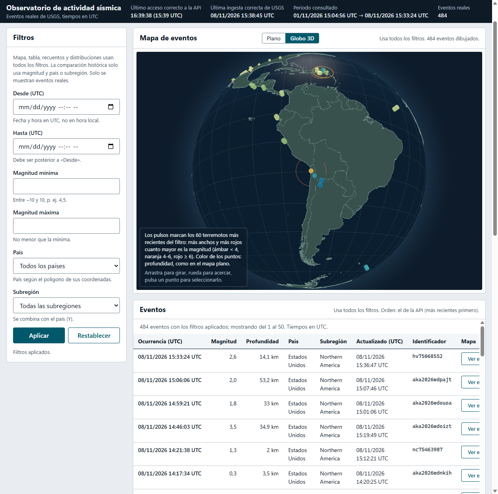
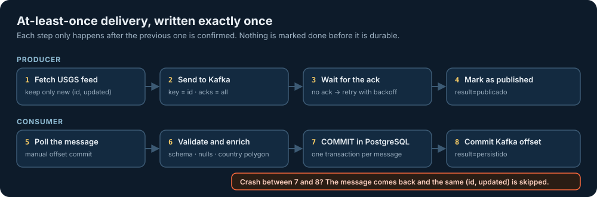

# Observatorio de actividad sísmica

Recoge en tiempo real los terremotos que publica el USGS, los mueve por **Kafka**, los valida y les asigna país por
coordenadas, los guarda en **PostgreSQL** y los enseña en un **panel Angular** con mapa plano y globo 3D.

La pregunta que responde: **¿dónde se está registrando actividad sísmica y cómo se compara con un periodo histórico
equivalente?**

<p align="center">
  
</p>

> Proyecto de Sistemas de Big Data (sesiones 1–8, RA1). La memoria técnica, con el análisis y las pruebas de aceptación,
> está en [docs/MEMORIA.md](docs/MEMORIA.md).

## Índice

1. [Cómo funciona](#cómo-funciona)
2. [Puesta en marcha](#puesta-en-marcha)
3. [Qué se ve en el panel](#qué-se-ve-en-el-panel)
4. [La API](#la-api)
5. [Operaciones habituales](#operaciones-habituales)
6. [Pruebas](#pruebas)
7. [Publicar el panel para la defensa (Netlify + ngrok)](#publicar-el-panel-para-la-defensa-netlify--ngrok)
8. [Configuración, puertos y listeners](#configuración-puertos-y-listeners)
9. [Solución de problemas](#solución-de-problemas)
10. [Estructura del repositorio](#estructura-del-repositorio)
11. [Cómo se ha desarrollado](#cómo-se-ha-desarrollado)

---

## Cómo funciona

<p align="center"></p>

Cinco servicios en Docker Compose, todos con la misma imagen de Python 3.12 (`backend/`):

| Servicio | Tecnología | Qué hace |
| --- | --- | --- |
| `producer` | Python + aiokafka | Cada 60 s descarga el feed de 24 h del USGS y publica solo los eventos nuevos o revisados |
| `kafka` | Apache Kafka 4.1 (KRaft) | Transporta los mensajes; topic `eventos.live` (y `eventos.replay` para la reproducción), clave = `id` del USGS |
| `consumer` | Python + aiokafka | Valida, manda a cuarentena lo que no se puede tratar, asigna país por polígono y escribe de forma idempotente |
| `postgres` | PostgreSQL 17 | Estado actual, historial de versiones, originales, cuarentena y registro de ingesta |
| `api` | FastAPI | Solo lectura. Es lo único que se expone por el túnel |

El **panel** (Angular + Leaflet + globe.gl) no es un servicio de Compose: se compila y se publica en Netlify, o se
ejecuta en local con `npm start`.

### Garantías de entrega

<p align="center"></p>

- El productor marca un evento como **publicado solo después del acuse de Kafka** (`acks=all`). Si Kafka no responde,
  reintenta con espera creciente (1, 2, 4, 8, 16, 30 s…).
- El consumidor guarda cada mensaje en **una transacción** y **confirma el offset solo después del `COMMIT`**. Si se cae
  entre ambos pasos, Kafka le vuelve a entregar el mensaje y la escritura idempotente lo descarta.

### Revisiones: estado actual frente a historial

<p align="center"></p>

El USGS corrige los terremotos (magnitud, profundidad…) y vuelve a publicarlos con otro `updated`. Por eso hay dos tablas:

- **Estado actual** (`live.evento_actual`): una fila por evento, que solo se sustituye si llega un `updated` más
  reciente.
- **Historial** (`live.versiones_evento`): una fila por `(event_id, updated)`, que nunca se sobrescribe.

Los recuentos y las distribuciones salen del estado actual, nunca de contar mensajes.

### Reglas de datos

- **País por coordenadas.** Punto en polígono contra Natural Earth (EPSG:4326, código `ADM0_A3`), nunca leyendo el texto
  `place`. Si no cae en ningún país (casi siempre, en el mar): «Sin país asignado».
- **Los nulos no se rellenan.** Sin magnitud o sin profundidad, el valor queda vacío y el panel lo marca como «ND».
- **Tiempos en UTC.** Ocurrencia, `updated` e ingesta se guardan por separado como `timestamptz`.
- **La reproducción va aparte.** El histórico de 2025 se reproduce por su propio topic y su propio esquema, y el panel lo
  rotula «REPRODUCCIÓN».

---

## Puesta en marcha

<p align="center"></p>

### Requisitos

- **Docker Desktop** con Compose v2, con los puertos 8000 y 9092 libres en `127.0.0.1`.
- **Node.js LTS**, para el panel.
- **Python 3.12+**, solo para descargar el histórico.

Todas las órdenes son de **PowerShell** y se ejecutan desde la raíz del repositorio.

### 1. Crear el `.env`

```powershell
Copy-Item .env.example .env
# Contraseña aleatoria para PostgreSQL; .env se guarda en UTF-8 sin BOM y no se sube a Git
$pw = -join ((48..57) + (65..90) + (97..122) | Get-Random -Count 24 | ForEach-Object { [char]$_ })
$texto = [IO.File]::ReadAllText("$PWD\.env") -replace '(?m)^POSTGRES_PASSWORD=[^\r\n]*', "POSTGRES_PASSWORD=$pw"
[IO.File]::WriteAllText("$PWD\.env", $texto, (New-Object Text.UTF8Encoding($false)))
git check-ignore .env      # debe imprimir ".env"
```

### 2. Levantar los cinco servicios

```powershell
docker compose up --build -d
docker compose ps                              # los cinco en "healthy" en unos 2 minutos
Invoke-RestMethod http://127.0.0.1:8000/status # eventos_reales sube tras el primer ciclo (60 s)
```

El orden de arranque da igual: cada servicio reintenta con espera creciente hasta que su dependencia responde.

### 3. Abrir el panel

```powershell
cd frontend
npm ci
npm start          # http://localhost:4200, contra la API local (frontend/public/config.json)
```

`npm start` comprueba antes que la copia del catálogo de países coincide con su huella (`npm run catalogo:verificar`).

### Parar y volver a arrancar

```powershell
docker compose down     # para y elimina los contenedores; los datos se conservan
docker compose up -d    # vuelve a arrancar con los mismos datos
```

> [!WARNING]
> **No uses `docker compose down -v`.** Borra los volúmenes `kafka_data` y `postgres_data`, y con ellos datos reales
> del feed que ya no se pueden volver a descargar (el feed solo cubre 24 h).

---

## Qué se ve en el panel

| Bloque | Qué muestra |
| --- | --- |
| Estado del sistema | Último acceso correcto a la API, última ingesta del USGS, periodo consultado y eventos reales. Si la API cae, lo avisa y conserva los últimos datos marcados como desactualizados |
| Origen de los datos | «En directo» o «REPRODUCCIÓN», y el interruptor de casos de prueba sintéticos (apagado por defecto) |
| Filtros | Fechas en UTC, magnitud mínima y máxima, país y subregión. Afectan a todos los bloques salvo la comparación histórica, que solo usa magnitud y país o subregión |
| Mapa | **Plano** (Leaflet): círculo por evento, tamaño = magnitud, color = profundidad. **Globo 3D** (globe.gl): pulsos en los 60 eventos más recientes, más grandes y más rojos cuanto mayor es la magnitud |
| Eventos | Tabla paginada; «Ver en el mapa» centra el evento en el plano o en el globo |
| Comparación histórica | Eventos de las últimas 24 h frente a la media diaria de 2025 (magnitud ≥ 4) |
| Recuentos y distribuciones | Por país o subregión, por hora UTC, por magnitud y por profundidad, con su vista en tabla |

El panel se refresca solo cada 60 s y se pausa cuando la pestaña está oculta. Las cifras describen lo que ha publicado el
USGS: no predicen terremotos ni evalúan el riesgo.

---

## La API

Base local: `http://127.0.0.1:8000`. Contrato completo en [docs/CONTRATO-API.md](docs/CONTRATO-API.md) y en
OpenAPI ([api.openapi.yaml](specs/001-esqueleto/contracts/api.openapi.yaml)); la API no publica `/docs` porque es lo que
queda expuesto por el túnel.

| Ruta | Para qué |
| --- | --- |
| `GET /health` | Vivo o no (lo usa el healthcheck) |
| `GET /status` | Recuentos, última ingesta y estado de Kafka y PostgreSQL |
| `GET /eventos` | Lista paginada con filtros |
| `GET /eventos/mapa` | GeoJSON para el mapa (hasta 5000 eventos, avisa si trunca) |
| `GET /recuentos/pais` · `/recuentos/subregion` · `/recuentos/hora` | Recuentos |
| `GET /distribuciones/magnitud` · `/distribuciones/profundidad` | Histogramas, con los nulos aparte |
| `GET /comparacion-historica` | Últimas 24 h frente a la media diaria de 2025 |

Filtros comunes: `desde`, `hasta` (ISO 8601, UTC), `magnitud_min`, `magnitud_max`, `pais`, `subregion`, `incluir_sinteticos` y
`modo=live|replay`; las listas, además, `limite` y `desplazamiento`.

```powershell
(Invoke-RestMethod "http://127.0.0.1:8000/eventos?magnitud_min=4&limite=5").eventos | Format-Table
```

---

## Operaciones habituales

<details>
<summary><b>Ver qué está haciendo cada servicio</b></summary>

```powershell
docker compose logs producer --since 2m     # result=publicado / omitido
docker compose logs consumer --since 2m     # result=persistido / omitido / rechazado
```

Los logs usan el formato `clave=valor`, por ejemplo
`service=producer result=publicado event_id=us7000abcd updated=...`.
</details>

<details>
<summary><b>Prueba de humo y casos controlados</b></summary>

```powershell
# Un evento sintético con acuse de Kafka; con --repeat 5 se omite como duplicado
docker compose exec producer python -m observatorio.producer.smoke
docker compose exec producer python -m observatorio.producer.smoke --repeat 5

# Ocho casos: nuevo, revisión, antigua, reenvío, magnitud nula, coordenadas inválidas, mar y profundidad negativa
docker compose exec -T producer python -m observatorio.producer.casos

# Borrar solo los sintéticos (los reales no se tocan)
Get-Content -Raw -Encoding utf8 scripts/borrar_sinteticos.sql | docker compose exec -T postgres sh -c 'psql -U "$POSTGRES_USER" -d "$POSTGRES_DB" -f -'
```

Los sintéticos llevan la marca «SINTÉTICO» y solo se ven en el panel con el interruptor encendido.
</details>

<details>
<summary><b>Histórico de 2025 y reproducción</b></summary>

La descarga se hace una vez, en el anfitrión, y no entra en Git:

```powershell
$env:PYTHONPATH = "$PWD\backend"
$env:HISTORICO_DIR = "$PWD\data\historico"
python -m observatorio.historico                         # data/historico/2025/eventos.geojson + manifest.json
docker compose exec producer python -m observatorio.replay
```

La reproducción manda 40 eventos por `eventos.replay` y se guardan en `replay.versiones_evento`, sin tocar
`eventos_reales`. En el panel se ven eligiendo «REPRODUCCIÓN».
</details>

<details>
<summary><b>Retención de Kafka</b></summary>

`eventos.live` conserva los mensajes **7 días** (`TOPIC_RETENTION_MS=604800000`). Para cambiarlo, edita el valor en
`.env` y recrea el productor con `docker compose up -d producer`, que reconcilia el topic (`action=topic_reconciliado`).
</details>

<details>
<summary><b>Aplicar cambios de esquema sin perder datos</b></summary>

`db/init/*.sql` solo se ejecuta sobre un volumen vacío. Los ficheros son idempotentes; para aplicarlos sobre un volumen
existente ([research.md, R-07](specs/001-esqueleto/research.md#r-07--evolución-del-esquema-sobre-volúmenes-existentes)):

```powershell
docker compose exec postgres sh -c 'for f in /docker-entrypoint-initdb.d/*.sql; do psql -v ON_ERROR_STOP=1 -U $POSTGRES_USER -d $POSTGRES_DB -f $f || exit 1; done'
```
</details>

---

## Pruebas

```powershell
docker compose run --rm --no-deps consumer pytest -q     # backend, sin Kafka ni PostgreSQL
cd frontend; npx ng test --watch=false                   # panel (Vitest + jsdom)
```

Las once pruebas de aceptación del enunciado, con sus evidencias, están en la [memoria, §13](docs/MEMORIA.md#s13).

---

## Publicar el panel para la defensa (Netlify + ngrok)

El panel se publica en Netlify y llega a la API de tu equipo por un túnel HTTPS de ngrok. Resumen (la guía completa,
con el plan B local, está en la [memoria, §14](docs/MEMORIA.md#s14)):

1. Levanta la pila y espera a que esté `healthy`.
2. Abre el túnel: `ngrok http 8000`, y copia la URL HTTPS.
3. Pon esa URL en `frontend/public/config.json` (`apiBaseUrl`, sin barra final). No la subas a Git.
4. En `.env`, `CORS_ORIGEN_NETLIFY=https://<tu-sitio>.netlify.app` y `docker compose up -d api`.
5. `npm run build` en `frontend/` y publica en Netlify (`netlify.toml` fija la carpeta y la redirección de la SPA).

> [!NOTE]
> La URL gratuita de ngrok puede cambiar cada vez que reinicias el túnel; si cambia, repite los pasos 3 a 5. El
> authtoken de ngrok se configura en tu equipo, nunca en Git ni en Angular.

---

## Configuración, puertos y listeners

Toda la configuración va en `.env`; la plantilla, sin secretos, es [.env.example](.env.example). Las más útiles:

| Variable | Por defecto | Qué controla |
| --- | --- | --- |
| `POSTGRES_PASSWORD` | (vacía) | Obligatoria: sin ella Compose no arranca |
| `POLL_INTERVAL_SECONDS` | `60` | Cada cuánto consulta el productor al USGS |
| `TOPIC_RETENTION_MS` | `604800000` | Retención de `eventos.live` (7 días) |
| `FEED_RETENTION_HOURS` | `48` | Cuánto se guardan las copias del feed en `data/usgs/` |
| `CORS_ORIGEN_NETLIFY` | (vacía) | Origen del panel publicado al que la API deja leer |
| `DATOS_DESACTUALIZADOS_SEGUNDOS` | `300` | A partir de cuándo `/status` considera vieja la ingesta |

| Puerto en el anfitrión | Servicio | Para qué |
| --- | --- | --- |
| `127.0.0.1:8000` | `api` | La API (el túnel de ngrok apunta aquí) |
| `127.0.0.1:9092` | `kafka` | Solo para inspeccionar desde el anfitrión (listener `HOST`) |

PostgreSQL (`5432`) no se publica: solo se llega desde la red de Compose. Dentro de Compose se usan siempre los nombres de
servicio (`kafka:19092`, `postgres:5432`), nunca `localhost`.

---

## Solución de problemas

| Síntoma | Qué hacer |
| --- | --- |
| `docker compose` falla nombrando `POSTGRES_PASSWORD` | Falta en `.env`: repite el paso 1 de la puesta en marcha |
| «port is already allocated» | `Get-NetTCPConnection -LocalPort 8000,9092 -State Listen` y detén el proceso que lo usa |
| `error during connect` o Docker no responde | Abre Docker Desktop y espera a que diga «Engine running» |
| El panel dice «La API no responde» | `docker compose ps`; si `api` está parada, `docker compose start api`. El panel se recupera solo |
| `eventos_reales` no sube | `docker compose logs producer --since 5m`: sin red, el productor reintenta solo |
| `npm start` falla en `catalogo:verificar` | `npm run catalogo:copiar` restaura la copia del catálogo |

---

## Estructura del repositorio

```text
backend/          Productor, consumidor y API (Python 3.12, una imagen para los tres) y sus tests
db/init/          Esquema SQL idempotente
frontend/         Panel Angular (Leaflet + globe.gl)
catalogo/         Países de Natural Earth (1:50m, 242 países) y su manifiesto
scripts/          Descarga del catálogo y limpieza de sintéticos
docs/             Memoria, contrato de la API, fuentes y licencias, enunciado e imágenes del README
specs/NNN-*/      Una carpeta por feature: spec, plan, tareas y evidencias
data/             Feed y histórico descargados (fuera de Git)
compose.yaml      Los cinco servicios
```

---

## Cómo se ha desarrollado

Con Spec-Driven Development ([GitHub Spec Kit](https://github.com/github/spec-kit)): cada feature tiene su carpeta en
`specs/NNN-nombre/` con `spec.md`, `plan.md` y `tasks.md` antes de escribir código, y su propia rama. En Cursor hay
cuatro subagentes (`analyst`, `architect`, `developer`, `verifier`) definidos en `.cursor/agents/`; la
[memoria, §16](docs/MEMORIA.md#s16) cuenta en qué features se usaron y en cuáles no.

| Feature | Alcance |
| --- | --- |
| 001-esqueleto | Compose con los cinco servicios, healthchecks, esquema SQL, prueba de humo y recuperación ante caídas |
| 002-ingesta-live | Productor USGS, versiones publicadas y reintentos |
| 003-consumidor | Calidad, cuarentena, punto en polígono y estado actual por versión |
| 004-historico-replay | Descarga de 2025 y reproducción aislada |
| 005-api | Consultas, comparación con 2025 y CORS |
| 006-panel | Panel Angular + Leaflet ([guía](specs/006-panel/quickstart.md)) |
| 007-memoria | [Memoria](docs/MEMORIA.md), casos sintéticos y pruebas de aceptación |
| 008-globo | Vista de globo 3D con pulsos (ampliación) |
| 009-i18n | Panel en español e inglés (ampliación) |

**Pendiente de hacer a mano por el alumno:** publicar el panel en Netlify. El túnel real de ngrok ya está probado
([memoria, §13](docs/MEMORIA.md#s13)) y la explicación individual está redactada para que el alumno la revise
([memoria, §15](docs/MEMORIA.md#s15)).

### Datos y licencias

- **Países:** Natural Earth Admin 0, 1:50m, versionado en `catalogo/`. Se regenera con
  `python scripts/descargar_paises.py`, que valida `ADM0_A3`, geometrías y CRS y escribe la huella en
  `catalogo/paises.manifest.json`.
- **Terremotos:** USGS (dominio público). El feed y el histórico se descargan en `data/` y no se suben a Git.
- Detalle en [docs/FUENTES-Y-LICENCIAS.md](docs/FUENTES-Y-LICENCIAS.md).
