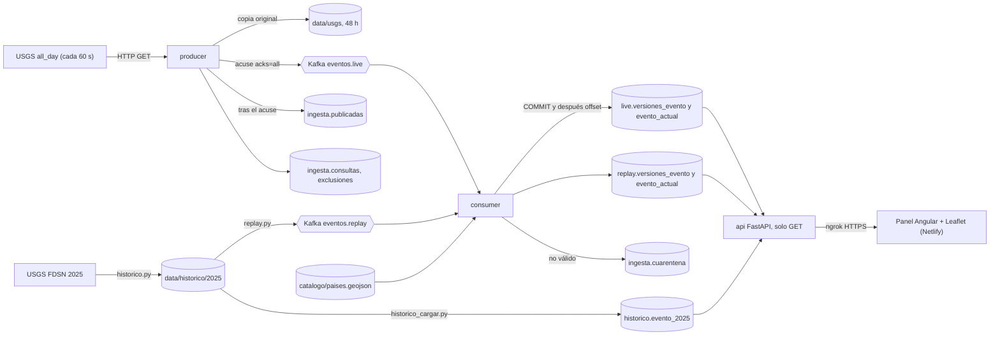
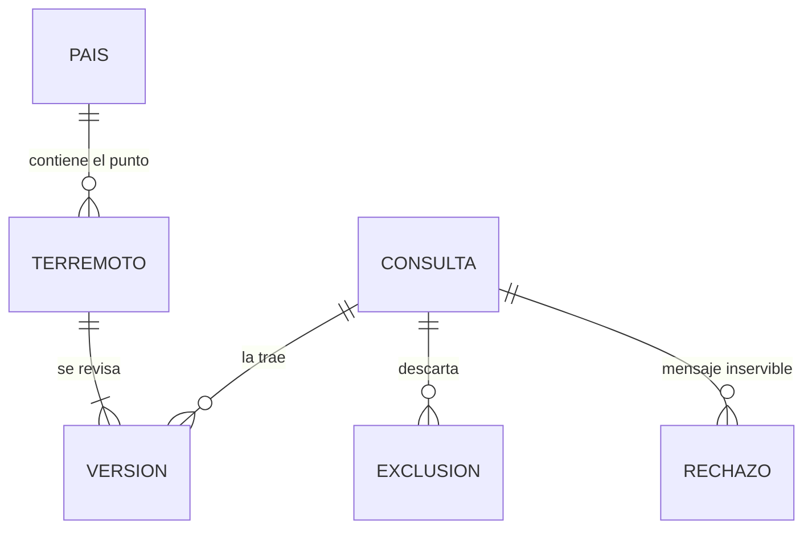
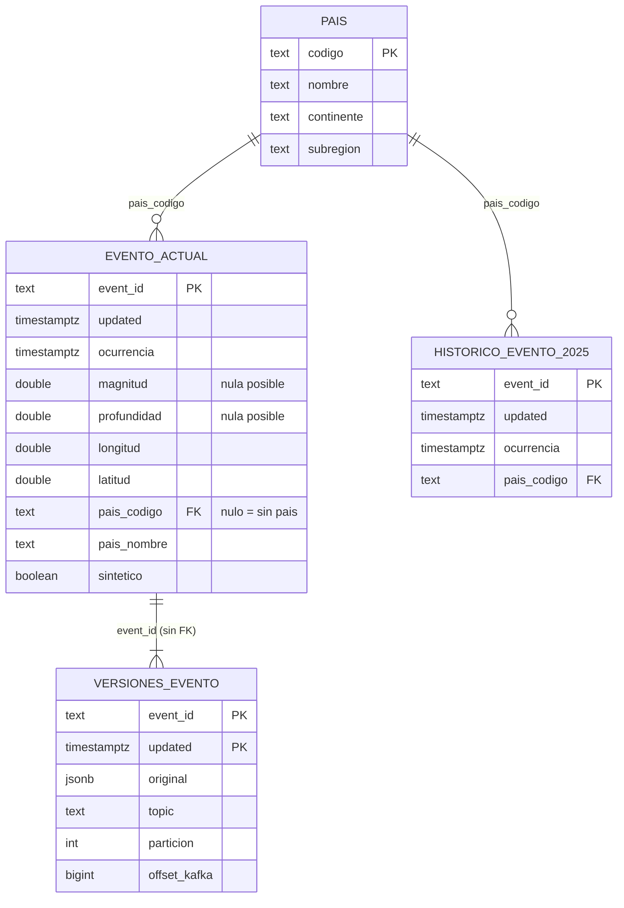

# Memoria del Observatorio de actividad sísmica

Esta es la memoria técnica del proyecto: cómo viaja un terremoto desde USGS hasta el mapa, qué datos se guardan, con
qué calidad, cuánto cuesta y qué no se ha podido comprobar. El enunciado está en [ENUNCIADO.md](ENUNCIADO.md) y el
contrato de la API en [CONTRATO-API.md](CONTRATO-API.md).

**Estado de esta versión.** Están escritas las partes técnicas, las once pruebas de aceptación (§13) y las tres
conclusiones del análisis (§12), con cifras reales del **2026-11-08**. Faltan, y están marcadas donde corresponden: la URL
del panel en Netlify (**PENDIENTE (alumno)**), el túnel real de ngrok (pendiente del alumno) y la explicación individual
(**la escribe el alumno**).

## Cómo leer las cifras

Ninguna cifra está escrita a mano: cada una lleva la consulta o el comando que la produce y la fecha.

- **`Qnn`**: consulta numerada de [memoria/consultas.sql](memoria/consultas.sql). Se ejecuta con
  `docker compose exec -T postgres psql … -f -` (instrucciones en la cabecera del fichero) y solo hace `SELECT`.
  Su salida literal está en [memoria/consultas.resultado.txt](memoria/consultas.resultado.txt), ejecutada el
  **2026-11-08 a las 14:23 UTC**. Es la «instantánea» de esta memoria.
- **`Cnn`**: comando de apoyo (hardware, latencia, procedencia, FDSN, Git…) en
  [memoria/comandos.md](memoria/comandos.md), con su resultado del 2026-11-08.
- **`M1`–`M6`**: secciones de [memoria/mediciones.md](memoria/mediciones.md), generado por
  `python -m observatorio.mediciones` el **2026-11-08 a las 14:12 UTC** (copia en
  [specs/007-memoria/evidencias/mediciones.md](../specs/007-memoria/evidencias/mediciones.md)).
- **Datos reales y sintéticos.** Toda consulta de calidad y de análisis excluye los casos de prueba: con
  `NOT sintetico` en `live` y `replay`, con el prefijo `synthetic-` de la clave en `ingesta.cuarentena` (no tiene la
  columna) y sin nada en `historico`, que solo contiene datos reales. La base tiene hoy 5 eventos y 7 versiones
  sintéticos de las pruebas de aceptación (Q06); los números de esta memoria son siempre los **reales**. Las
  mediciones de rendimiento usan datos sintéticos en un esquema temporal (`medicion`) que se borra al acabar (§8).
- **Las cifras de `live` cambian cada minuto**: el productor sigue consultando USGS. Las citadas son las de la
  instantánea de las 14:23 UTC (479 terremotos reales, 526 versiones). Al repetir las consultas saldrán números
  algo mayores; lo que no cambia es el histórico (18.302 filas), el catálogo (242 países) y el hueco de noviembre.

## Índice

1. [Flujo completo](#s1)
2. [Diccionario de datos](#s2)
3. [Consultas y procedencia (y el hueco del 2 al 8 de noviembre)](#s3)
4. [Modelo de datos: conceptual, lógico y físico](#s4)
5. [Calidad de los datos](#s5)
6. [Limitaciones](#s6)
7. [Complejidad de las operaciones](#s7)
8. [Mediciones de tiempo y memoria](#s8)
9. [¿Qué pasaría con 100 millones de registros?](#s9)
10. [Costes](#s10)
11. [Escalado, limitaciones y mejoras](#s11)
12. [Análisis y conclusiones](#s12)
13. [Pruebas de aceptación](#s13)
14. [Procedimiento de defensa](#s14)
15. [Explicación individual](#s15) (**la escribe el alumno**)
16. [Transparencia del proceso](#s16)
17. [Rúbrica: dónde está cada evidencia](#s17)
18. [Ficheros de apoyo](#s18)

---

<a id="s1"></a>
## 1. Flujo completo

Cinco servicios en [compose.yaml](../compose.yaml) (`kafka`, `postgres`, `producer`, `consumer`, `api`) con una
imagen Python compartida; el panel Angular vive fuera, en Netlify, y llega a la API por un túnel ngrok.



Dos garantías atraviesan todo el flujo: **un evento solo se marca como publicado después del acuse de Kafka** y **el
offset solo se confirma después del `COMMIT` en PostgreSQL**. Si el proceso cae entre una cosa y otra, el mensaje se
reenvía y las restricciones únicas lo absorben (procesamiento al menos una vez con escritura idempotente).

| Paso | Qué ocurre | Fichero | Tabla o topic | Log de ejemplo (real, 2026-11-08) |
| --- | --- | --- | --- | --- |
| 1 | Descargar `all_day` y anotar el intento | [ciclo.py](../backend/observatorio/producer/ciclo.py) (`una_pasada`) | `ingesta.consultas` | `service=producer result=listo component=usgs features=204 publicados=0 excluidos=0 copia_nueva=true` |
| 2 | Guardar el GeoJSON original (SHA-256, retención 48 h) | [feed.py](../backend/observatorio/producer/feed.py) (`conservar_original`) | `data/usgs/*.geojson` | `copia_nueva=true` en el mismo log |
| 3 | Excluir lo que no es `earthquake` y omitir versiones ya publicadas | `feed.py` (`clasificar`) | lee `ingesta.publicadas`; escribe `ingesta.exclusiones` | `result=omitido component=usgs omitidos=…` |
| 4 | Publicar con acuse; clave Kafka = `id` | `ciclo.py`, [contrato.py](../backend/observatorio/common/contrato.py) (`construir_mensaje`) | topic `eventos.live` | `service=producer result=publicado event_id=nn00926785 updated=1794146988096 source=usgs` |
| 5 | Marcar la versión como publicada | `ciclo.py`, tras el acuse | `ingesta.publicadas` | (el mismo `publicado`) |
| 6 | Validar el mensaje; lo inservible, a cuarentena con motivo | [app.py](../backend/observatorio/consumer/app.py), [decision.py](../backend/observatorio/consumer/decision.py), [calidad.py](../backend/observatorio/consumer/calidad.py) | `ingesta.cuarentena` | `result=rechazado event_id=… motivo=… topic=… partition=… offset=…` |
| 7 | Asignar el país por punto en polígono | [catalogo.py](../backend/observatorio/common/catalogo.py) (`IndicePaises.asignar`) | `ingesta.pais` | `pais="Estados Unidos"` al final del log del paso 8 |
| 8 | Una transacción: versión + estado actual; después el offset | [persistencia.py](../backend/observatorio/consumer/persistencia.py) | `live.versiones_evento`, `live.evento_actual` | `service=consumer result=persistido event_id=nn00926785 updated=1794146988096 topic=eventos.live partition=0 offset=185 pais="Estados Unidos"`; un reenvío da `result=omitido reason=duplicado` |
| 9 | Descargar 2025 por meses y cargarlo | [historico.py](../backend/observatorio/historico.py), [historico_cargar.py](../backend/observatorio/historico_cargar.py) | `data/historico/2025/`, `historico.evento_2025` | `intervalo=2025-01-01 features=1413` |
| 10 | Reproducción acelerada del histórico | [replay.py](../backend/observatorio/replay.py) | topic `eventos.replay` → `replay.*` | `result=persistido … etiqueta=REPRODUCCIÓN` |
| 11 | Consultar (solo lectura) | [api/rutas.py](../backend/observatorio/api/rutas.py), [api/consultas.py](../backend/observatorio/api/consultas.py) | `live.evento_actual`, `replay.evento_actual`, `historico.evento_2025`, `ingesta.consultas` | `service=api result=info method=GET path=/status status=200 ms=19` |
| 12 | Mostrar mapa, tabla, recuentos y comparación | [frontend/src/app](../frontend/src/app) | — (lee `public/config.json`) | peticiones `GET` de [CONTRATO-API.md](CONTRATO-API.md) |

Reglas de dominio que el flujo cumple y que conviene tener presentes al leer el resto:

- El **estado actual** guarda solo la versión con el `updated` más reciente; el **historial** guarda cada
  `(event_id, updated)` sin sobrescribir. Todas las cifras (recuentos, distribuciones, mapa) salen del estado actual,
  nunca de contar mensajes.
- El **país** sale de un punto en polígono sobre EPSG:4326 con `ADM0_A3`, nunca del texto de `place`. Sin polígono que
  lo contenga: «Sin país asignado». No se asigna el país más cercano.
- Los **nulos** no se rellenan con 0. Lo que no se puede tratar va a `ingesta.cuarentena` con motivo y el original.
- La **reproducción** usa topic y tablas propios, y el log lleva `etiqueta=REPRODUCCIÓN`; conserva el tiempo original
  (`ocurrencia`) y añade el de reproducción (`ingested_at`).
- Todos los instantes se guardan en UTC (`timestamptz`), separando ocurrencia (`properties.time`), `updated` de USGS
  e ingesta/proceso.

---

<a id="s2"></a>
## 2. Diccionario de datos

### 2.1 Campos del feed de USGS

Fuente: [formato GeoJSON summary de USGS](https://earthquake.usgs.gov/earthquakes/feed/v1.0/geojson.php) (tipos
consultados el 2026-11-08) y la muestra real de `ingesta`. «Disponible» es el porcentaje de versiones reales con valor
no nulo en esa muestra (Q15; 526 versiones). Que un campo salga al 100 % **no garantiza** que USGS no envíe nulos
mañana: el consumidor acepta `mag` y profundidad ausentes y los guarda como `NULL`.

| Campo | Tipo (USGS) | Unidad | Disponible (Q15) | Cómo se usa |
| --- | --- | --- | --- | --- |
| `id` | texto | — | 100 % | Clave del evento y clave de Kafka |
| `properties.time` | entero largo | ms desde Unix epoch (UTC) | 100 % | `ocurrencia` |
| `properties.updated` | entero largo | ms desde Unix epoch (UTC) | 100 % | `updated`; decide qué versión es la actual |
| `properties.mag` | decimal | sin unidad (escala según `magType`) | 100 % | `magnitud`; nula si falta |
| `properties.magType` | texto | — | 100 % | Solo en `original`; no se compara entre tipos (§6) |
| `properties.type` | texto | — | 100 % | Filtro `earthquake`; el resto se excluye con motivo |
| `properties.place` | texto | — | 100 % | Solo en `original`; **no** se usa para el país |
| `geometry.coordinates` | `[longitud, latitud, profundidad]` | grados (WGS84) y km | 100 % (profundidad también) | `longitud`, `latitud`, `profundidad` |
| `properties.status` | texto | — | 100 % | Solo en `original` (`automatic` o `reviewed`) |
| `properties.title`, `url`, `detail`, `code`, `ids`, `sources`, `types`, `net` | texto | — | 100 % | Solo en `original` |
| `properties.tsunami`, `sig`, `nst`, `dmin`, `rms`, `gap` | entero o decimal | — (según USGS) | 100 % | Solo en `original` |
| `properties.felt`, `cdi` | entero, decimal | informes; intensidad | 7,79 % (41 de 526) | Solo en `original` |
| `properties.mmi` | decimal | intensidad | 2,28 % (12 de 526) | Solo en `original` |
| `properties.alert` | texto | — | 0,38 % (2 de 526) | Solo en `original` |
| `properties.tz` | entero | — | 0 % (siempre `null`) | Sin uso |

Observaciones: el feed trae `title`, que la página del formato no lista. Los campos opcionales (`felt`, `cdi`, `mmi`,
`alert`) existen en pocos eventos; se conservan en `original` y no se promueven a columna porque ni la API ni el
panel los usan (ejemplos reales en Q15b). Las unidades de `nst`, `dmin`, `rms` y `gap` no se verificaron contra la
documentación porque no se usan.

**Frecuencia.** El feed es una ventana móvil de 24 h que USGS regenera cada minuto y que el productor consulta cada
60 s: intervalo mediano 60,2 s, p95 60,2 s, máximo 105,0 s en 190 intervalos (Q13). Cada respuesta repite toda la
ventana: 45.041 apariciones de eventos para 526 versiones distintas, unas 85,6 por versión (Q17b).

**Errores.** En 192 consultas hay 192 respuestas HTTP 200, ninguna otra y ningún error (Q07, Q08). Los 429/5xx y los
timeouts se reintentan con espera progresiva (`result=reintento`); no ha ocurrido ninguno en el periodo observado, así
que ese camino está cubierto por pruebas unitarias y no por datos reales.

**Latencia.** `ingesta.consultas` no la guarda. Muestra aparte de 8 peticiones (C3): total mediana 102,9 ms (de 84,3 a
116,2 ms), primer byte mediana 70,7 ms. Es una muestra pequeña desde un solo punto de red.

### 2.2 Tablas de PostgreSQL

Cuatro esquemas: `live` (datos reales en directo), `replay` (reproducción), `ingesta` (control, catálogo y cuarentena)
e `historico` (denominador de 2025). Hay **99 columnas** en 11 tablas (Q01). `replay` tiene exactamente las mismas 26
columnas que `live`, con el mismo tipo y la misma nulabilidad (Q03: 0 columnas distintas); solo cambia el valor de
`mode`. Por eso se describen una vez. Esta sección se generó leyendo `information_schema` y falla si sobra o falta
alguna columna (Q02 muestra la definición completa).

#### `live.evento_actual` y `replay.evento_actual` (14 columnas en cada esquema)

| Columna | Tipo | ¿Nulo? | Origen y unidad | Descripción |
| --- | --- | --- | --- | --- |
| `event_id` | text | no | USGS `id` | Identificador del evento. Clave primaria y clave de Kafka. |
| `updated` | timestamptz | no | USGS `properties.updated` (ms epoch, guardado en UTC) | Última revisión aceptada. Solo la sustituye una más reciente. |
| `ocurrencia` | timestamptz | no | USGS `properties.time` (ms epoch, UTC) | Instante en que ocurrió el terremoto. |
| `magnitud` | double precision | sí | USGS `properties.mag` (sin unidad) | NULL si USGS no la informa; nunca se rellena con 0. El tipo (`magType`) queda en `original`. |
| `profundidad` | double precision | sí | USGS `geometry.coordinates[2]` (km) | NULL si falta. Puede ser negativa (por encima del nivel de referencia). |
| `longitud` | double precision | no | USGS `geometry.coordinates[0]` (grados, EPSG:4326) | Finita y en [-180, 180]; si no, el mensaje va a cuarentena. |
| `latitud` | double precision | no | USGS `geometry.coordinates[1]` (grados, EPSG:4326) | Finita y en [-90, 90]; si no, cuarentena. |
| `pais_codigo` | text | sí | Derivado: `ADM0_A3` del catálogo por punto en polígono | NULL = «Sin país asignado». Clave foránea a `ingesta.pais`. |
| `pais_nombre` | text | no | Derivado: `NAME_ES` del catálogo (o `ADMIN`, o el código) | «Sin país asignado» cuando no hay polígono que contenga el punto. |
| `source` | text | no | Mensaje Kafka `source` | `usgs` en datos reales; `synthetic-…` en casos de prueba. |
| `mode` | text | no | Mensaje Kafka `mode` | Siempre `live` en `live.*` y `replay` en `replay.*` (CHECK). |
| `sintetico` | boolean | no | Derivado de `source` y del `id` | `true` si ambos empiezan por `synthetic-`; un CHECK impide mezclar. |
| `ingested_at` | timestamptz | no | Mensaje Kafka `ingested_at` (UTC) | Instante de ingesta; en replay es el tiempo de reproducción. |
| `processed_at` | timestamptz | no | Sistema (`clock_timestamp()`) | Instante en que el consumidor escribió la fila. |

#### `live.versiones_evento` y `replay.versiones_evento` (12 columnas en cada esquema)

| Columna | Tipo | ¿Nulo? | Origen y unidad | Descripción |
| --- | --- | --- | --- | --- |
| `event_id` | text | no | USGS `id` | Con `updated` forma la clave primaria: una fila por versión recibida. |
| `updated` | timestamptz | no | USGS `properties.updated` (UTC) | Versión del evento. El historial nunca se sobrescribe. |
| `schema_version` | smallint | no | Mensaje Kafka `schema_version` | Versión del contrato del mensaje (hoy 1). |
| `source` | text | no | Mensaje Kafka `source` | Igual que en el estado actual. |
| `mode` | text | no | Mensaje Kafka `mode` | `live` o `replay` según el esquema (CHECK). |
| `sintetico` | boolean | no | Derivado de `source` y del `id` | Igual que en el estado actual. |
| `ingested_at` | timestamptz | no | Mensaje Kafka `ingested_at` (UTC) | Instante de ingesta o de reproducción. |
| `processed_at` | timestamptz | no | Sistema (`clock_timestamp()`) | Instante de escritura del consumidor. |
| `topic` | text | no | Registro Kafka | Topic del que se leyó (`eventos.live` o `eventos.replay`). |
| `particion` | integer | no | Registro Kafka | Partición del registro. |
| `offset_kafka` | bigint | no | Registro Kafka | Offset del registro; con topic y partición identifica la entrega. |
| `original` | jsonb | no | Mensaje Kafka completo (JSON) | Envoltorio v1 con el evento GeoJSON de USGS sin tocar: de aquí salen `magType`, `place`, `status`, `type`, etc. |

#### `historico.evento_2025` (10 columnas)

| Columna | Tipo | ¿Nulo? | Origen y unidad | Descripción |
| --- | --- | --- | --- | --- |
| `event_id` | text | no | USGS `id` | Clave primaria; una fila por evento. |
| `updated` | timestamptz | no | USGS `properties.updated` (UTC) | Revisión incluida en la extracción; solo una posterior la sustituye. |
| `ocurrencia` | timestamptz | no | USGS `properties.time` (UTC) | CHECK: dentro de 2025, así el denominador son 365 días. |
| `magnitud` | double precision | sí | USGS `properties.mag` | NULL si no se informa. |
| `profundidad` | double precision | sí | USGS `geometry.coordinates[2]` (km) | NULL si falta. |
| `longitud` | double precision | no | USGS `geometry.coordinates[0]` (grados) |  |
| `latitud` | double precision | no | USGS `geometry.coordinates[1]` (grados) |  |
| `pais_codigo` | text | sí | Derivado: `ADM0_A3` por punto en polígono | NULL = «Sin país asignado». FK a `ingesta.pais`. |
| `pais_nombre` | text | no | Derivado: nombre del catálogo | «Sin país asignado» si no hay polígono. |
| `cargado_en` | timestamptz | no | Sistema (`clock_timestamp()`) | Instante de la carga o de la última revisión aplicada. |

#### `ingesta.consultas` (12 columnas)

| Columna | Tipo | ¿Nulo? | Origen y unidad | Descripción |
| --- | --- | --- | --- | --- |
| `id` | bigint | no | Sistema (identidad) | Orden de los intentos de descarga. |
| `url` | text | no | Configuración `USGS_FEED_URL` | URL consultada. |
| `acabada_en` | timestamptz | no | Sistema (`clock_timestamp()`) | Instante en que terminó el intento (no el de inicio). |
| `http_status` | integer | sí | Respuesta HTTP | NULL si no hubo respuesta (error de red). |
| `bytes` | integer | sí | Cuerpo de la respuesta (bytes) |  |
| `sha256` | text | sí | Derivado: huella del cuerpo | Decide si se guarda una copia nueva en `data/usgs/`. |
| `features` | integer | sí | Derivado: nº de features del GeoJSON |  |
| `publicados` | integer | sí | Derivado | Versiones publicadas con acuse en esa pasada. |
| `omitidos` | integer | sí | Derivado | Versiones ya publicadas, omitidas. |
| `excluidos` | integer | sí | Derivado | Eventos excluidos (p. ej. `type` distinto de `earthquake`); el motivo va en `ingesta.exclusiones`. |
| `copia_nueva` | boolean | sí | Derivado | `true` si se escribió un fichero nuevo en `data/usgs/`. |
| `error` | text | sí | Derivado | Motivo del fallo (`http_503`, `red`, `json`…); NULL si la pasada fue correcta. |

#### `ingesta.publicadas` (3 columnas)

| Columna | Tipo | ¿Nulo? | Origen y unidad | Descripción |
| --- | --- | --- | --- | --- |
| `event_id` | text | no | USGS `id` | Con `updated_ms` forma la clave primaria. |
| `updated_ms` | bigint | no | USGS `properties.updated` (ms epoch) | Se conserva en milisegundos, sin convertir. |
| `publicada_en` | timestamptz | no | Sistema (`clock_timestamp()`) | Instante del acuse de Kafka. |

#### `ingesta.exclusiones` (6 columnas)

| Columna | Tipo | ¿Nulo? | Origen y unidad | Descripción |
| --- | --- | --- | --- | --- |
| `id` | bigint | no | Sistema (identidad) |  |
| `consulta_id` | bigint | sí | Derivado | Consulta en la que se vio (referencia lógica a `ingesta.consultas.id`, sin FK). |
| `event_id` | text | sí | USGS `id` |  |
| `tipo` | text | sí | USGS `properties.type` | Tipo que motivó la exclusión. |
| `motivo` | text | no | Derivado | Motivo de la exclusión. |
| `visto_en` | timestamptz | no | Sistema (`clock_timestamp()`) |  |

#### `ingesta.cuarentena` (9 columnas)

| Columna | Tipo | ¿Nulo? | Origen y unidad | Descripción |
| --- | --- | --- | --- | --- |
| `id` | bigint | no | Sistema (identidad) |  |
| `motivo` | text | no | Derivado: lista cerrada de motivos | Por qué no se pudo tratar (`json_ilegible`, `coordenadas_fuera_de_rango`, …). |
| `detalle` | text | sí | Derivado | Dato concreto que falló (p. ej. `lon=200 lat=10`). |
| `topic` | text | no | Registro Kafka |  |
| `particion` | integer | no | Registro Kafka |  |
| `offset_kafka` | bigint | no | Registro Kafka | Con topic y partición es único: una reentrega no duplica. |
| `clave` | bytea | sí | Registro Kafka (bytes) | La clave tal como llegó; en un mensaje correcto es el `id`. |
| `original` | bytea | sí | Registro Kafka (bytes) | El valor tal como llegó, sin interpretar: referencia al original. |
| `recibido_en` | timestamptz | no | Sistema (`clock_timestamp()`) |  |

#### `ingesta.pais` (4 columnas)

| Columna | Tipo | ¿Nulo? | Origen y unidad | Descripción |
| --- | --- | --- | --- | --- |
| `codigo` | text | no | Catálogo `ADM0_A3` | Clave primaria; único en el catálogo (se comprueba al arrancar). No siempre es un código ISO. |
| `nombre` | text | no | Catálogo `NAME_ES` (o `ADMIN`) |  |
| `continente` | text | sí | Catálogo `CONTINENT` |  |
| `subregion` | text | sí | Catálogo `SUBREGION` |  |

#### `ingesta.version_esquema` (3 columnas)

| Columna | Tipo | ¿Nulo? | Origen y unidad | Descripción |
| --- | --- | --- | --- | --- |
| `version` | integer | no | Sistema | Versión del esquema aplicada (1 a 5). |
| `nombre` | text | no | Sistema | Nombre de la migración. |
| `aplicada_en` | timestamptz | no | Sistema (`clock_timestamp()`) |  |

---

<a id="s3"></a>
## 3. Consultas y procedencia

### 3.1 Feed `all_day` (datos recientes)

`ingesta.consultas` es el registro de cada intento. Resumen a las 14:23 UTC del 2026-11-08 (Q07):

| Concepto | Valor |
| --- | --- |
| Consultas | 192, desde 2026-11-02 14:45:30 UTC hasta 2026-11-08 14:22:32 UTC |
| Respuestas HTTP 200 / otras / con error | 192 / 0 / 0 |
| Copias nuevas en `data/usgs/` | 187 (97,4 %): casi cada respuesta difiere de la anterior |
| Bytes recibidos | 32.268.356 (media 168.064 por respuesta) |
| Apariciones de eventos / publicadas / omitidas / excluidas | 45.041 / 526 / 44.515 / 0 |

Cada versión con acuse tiene su versión persistida y al revés: 526 y 526, 0 sin persistir, 0 sin acuse (Q12).

### 3.2 Histórico 2025 (FDSN)

Descargado una vez con `python -m observatorio.historico` y reutilizado. El manifiesto
(`data/historico/2025/manifest.json`, fuera de Git) dice: extracción el 2026-11-02T15:17:20Z, 12 consultas (una por
mes, todas HTTP 200, 13.011.906 bytes), 18.302 eventos y 0 duplicados de extremo; ningún mes llegó al tope de 20.000,
así que no hubo que partir intervalos (C1). Filtros: año 2025, mundial, `minmagnitude=4`, `eventtype=earthquake`.

`count(*)` de `historico.evento_2025` es **18.302**, con 18.302 ids distintos: coincide con el manifiesto (Q11). Se
cargaron entre las 15:57:43 y las 15:57:45 UTC del 2 de noviembre. El histórico es una instantánea del catálogo en la
fecha de extracción, no el registro de todas las revisiones pasadas.

### 3.3 Catálogo geográfico

`catalogo/paises.geojson` (Natural Earth v5.1.2, 242 entidades, 2.306.248 bytes) está en Git con su manifiesto y su
huella SHA-256 `94e49353…f636af6`, que coincide con la del manifiesto (C1). `ADM0_A3` se comprueba único al arrancar
(un repetido es un error de arranque) y se carga en `ingesta.pais`.

### 3.4 Qué vive fuera de Git y cómo se regenera

| Dato | Dónde | En Git | Cómo se regenera |
| --- | --- | --- | --- |
| Copias del feed | `data/usgs/*.geojson`, retención 48 h (28 ficheros, 4.142.219 bytes ahora, C6) | No (`data/` ignorado) | No se regeneran: la ventana de 24 h pasó. Cada versión sigue en `live.versiones_evento.original` |
| Histórico 2025 | `data/historico/2025/eventos.geojson` (12.988.889 bytes) y `manifest.json` | No | `python -m observatorio.historico` (12 consultas FDSN) |
| Carga del histórico | `historico.evento_2025` | No (volumen) | `docker compose exec producer python -m observatorio.historico_cargar` (idempotente) |
| Catálogo de países | `catalogo/paises.geojson` | Sí | Ya en el repositorio; `scripts/descargar_paises.py` documenta su origen |
| Estado actual e historial | volumen `postgres_data` | No | Volviendo a consumir Kafka (retención de 7 días) o, para el estado actual, desde `live.versiones_evento` al arrancar el consumidor |
| Reproducción | `replay.*` | No | `docker compose exec producer python -m observatorio.replay` |

### 3.5 El hueco del 2 al 8 de noviembre de 2026

El sistema estuvo apagado casi seis días y **ese hueco no se recupera solo**: el feed `all_day` solo mira 24 h hacia
atrás, así que al volver a encenderlo lo que ocurrió antes de esas 24 h se perdió.

**Cómo se ve en los datos.**

- Entre la última consulta antes de la parada (2026-11-02 17:11:26 UTC) y la primera después (2026-11-08 13:40:45 UTC)
  pasaron **5 días 20 h 29 min** sin ninguna consulta (Q09a).
- Por día: el 2 de noviembre hay 148 consultas (10,3 % de las 1.440 de un día completo, que es lo esperable porque el
  sistema solo estuvo encendido unas 2,4 h), del 3 al 7 hay 0 y el 8 está incompleto porque el día no ha terminado
  (Q09b).
- En los datos de eventos: no hay ningún terremoto real con ocurrencia entre 2026-11-02 17:05:05 UTC y
  2026-11-07 14:01:40 UTC, un salto de **4 d 20 h 56 min** (Q10b); por día, 191 eventos el 2 de noviembre, 0 del 3 al
  6 y 87 el 7 (Q10).
- El panel lo habría avisado: `/status` marca `datos_desactualizados` cuando pasan más de 300 s sin una consulta
  correcta (umbral configurable).

**Cuántos eventos faltan.** El recuento del catálogo FDSN en ese tramo (2026-11-02T17:11:26Z a 2026-11-07T13:40:45Z,
el segundo límite es 24 h antes de la primera consulta tras el reinicio) es de **1.171 terremotos** de todas las
magnitudes y **81 con magnitud ≥ 4**; la base tiene 0 de ellos (C5). El tope de la fuente es 20.000, así que una sola
consulta bastaría.

**Cómo se recuperaría** (documentado, **no ejecutado**: esta feature solo lo documenta):

1. **Delimitar el intervalo** con Q09a (últimas y primeras consultas) y Q10b (salto de ocurrencias). Lo que cubre la
   primera consulta posterior es la ventana de 24 h; hay que recuperar desde la última consulta anterior hasta 24 h
   antes de la primera posterior.
2. **Contar** con el endpoint `count` de FDSN (C5) para saber si cabe en una consulta. Si el recuento llega a 20.000,
   o la consulta responde HTTP 400 por exceso, se parte el intervalo por la mitad de forma recursiva, que es lo que
   hace `observatorio.historico.cubrir` con `partir`; nunca se recorta la respuesta. Un 204 es un intervalo vacío.
3. **Descargar** por intervalos con `format=geojson&eventtype=earthquake&orderby=time-asc` y los dos extremos del
   hueco. Para igualar el feed hay que **no** poner `minmagnitude` (el feed trae todas las magnitudes y el histórico
   solo las ≥ 4). Los extremos que FDSN incluye en ambos intervalos se deduplican por `(id, updated)`
   (`deduplicar`) y se guarda un manifiesto con consultas, fecha y número de registros, como con 2025.
4. **Cargar por el camino normal** para no inventar otro: el GeoJSON de FDSN tiene la misma forma que el del feed, así
   que `ciclo.una_pasada` lo procesa con `USGS_FEED_URL` apuntando a la consulta FDSN: clasifica, omite lo ya
   publicado, publica en `eventos.live` con acuse, marca `ingesta.publicadas` y el consumidor persiste con país. Habría
   que ejecutar **una sola pasada** (el bucle repetiría cada 60 s). El `ingested_at` de esos eventos será la hora de la
   recuperación.
5. **Comprobar**: Q10b ya no muestra el salto; `count(*)` de `live.evento_actual` en el tramo iguala el recuento FDSN
   del momento (puede diferir en unos pocos si USGS ha añadido o revisado desde entonces); Q12 sigue en 0 y 0.

**Qué no se puede hacer con este procedimiento.**

- `observatorio.historico` hoy solo recorre los meses de un año (`HISTORICO_ANIO`) y `url_consulta` siempre añade
  `minmagnitude` (4 por defecto) porque `cubrir` no lo recibe. Recuperar el hueco completo exige dos cambios pequeños
  (intervalo y magnitud mínima como parámetros) que **no están hechos**.
- FDSN devuelve solo la **última versión** de cada evento: se perdieron las versiones intermedias, y el historial de
  esos eventos empezaría en su versión final.
- Los retrasos de actualidad de los eventos recuperados serán de días (Q23 los contaría como retraso de ingesta):
  habría que excluirlos de esa medida o declararlos.
- No distingue un evento que USGS eliminó o fusionó dentro del hueco de uno que sigue vigente (reconciliación,
  fuera del alcance mínimo del enunciado).

---

<a id="s4"></a>
## 4. Modelo de datos: conceptual, lógico y físico

### 4.1 Modelo conceptual

Un **terremoto** (evento sísmico) tiene muchas **versiones** a lo largo del tiempo, ocurre en un **punto** que cae, o
no, dentro de un **país** del catálogo, y llega al sistema a través de una **consulta** al feed (o de una
reproducción). Lo que no se puede tratar acaba como **rechazo en cuarentena**.



Una versión de un terremoto sin país sigue siendo un terremoto: la relación con `PAIS` es opcional.

### 4.2 Modelo lógico

Grano y clave de cada tabla:

| Tabla | Grano | Clave | Relaciones | Idempotencia |
| --- | --- | --- | --- | --- |
| `live.evento_actual` | un terremoto en directo | `event_id` | FK `pais_codigo` → `ingesta.pais` (nulo = sin país) | `ON CONFLICT (event_id) DO UPDATE … WHERE evento_actual.updated < EXCLUDED.updated`: solo una revisión más reciente sustituye la fila |
| `live.versiones_evento` | una versión recibida | `(event_id, updated)` | misma clave que el estado actual (sin FK: el historial no depende de él) | `ON CONFLICT (event_id, updated) DO NOTHING` |
| `replay.evento_actual`, `replay.versiones_evento` | igual, para reproducción | igual | igual | igual |
| `historico.evento_2025` | un terremoto de 2025 | `event_id` | FK `pais_codigo` | misma regla de `updated`; repetir la carga no cambia nada |
| `ingesta.pais` | un país del catálogo | `codigo` (`ADM0_A3`) | referenciada por las tres tablas de estado | `ON CONFLICT (codigo) DO UPDATE` al arrancar |
| `ingesta.publicadas` | una versión con acuse de Kafka | `(event_id, updated_ms)` | — | clave primaria |
| `ingesta.consultas` | un intento de descarga | `id` (identidad) | referida por `exclusiones.consulta_id` (sin FK) | — |
| `ingesta.exclusiones` | un evento excluido en una consulta | `id` | — | — |
| `ingesta.cuarentena` | un registro Kafka inservible | `id`; único `(topic, particion, offset_kafka)` | — | `ON CONFLICT DO NOTHING` por posición |
| `ingesta.version_esquema` | una migración aplicada | `version` | — | `ON CONFLICT DO NOTHING` |



**Por qué no hay tabla de dimensión de fecha.** La fecha de todo lo que se analiza sale de `ocurrencia`
(`timestamptz`): la hora UTC con `date_trunc('hour', ocurrencia)` y el día con `date_trunc('day', …)`. Una tabla
calendario añadiría un `JOIN` y una clave más sin ahorrar nada; la ventana horaria de 24 h sobre 100.000 filas tarda
1,447 ms con el índice por `ocurrencia` (M4). Lo que sí hace falta es **rellenar con ceros** las horas y los días sin
eventos: la API lo hace al construir la respuesta y Q10 lo muestra en SQL con `generate_series` y `LEFT JOIN` (los días
3 a 6 de noviembre salen con 0, no desaparecen).

### 4.3 Modelo físico (SQL literal de `db/init/`)

Copiado de los cinco ficheros de [db/init/](../db/init/) el 2026-11-08. Todos son idempotentes: se pueden volver a
ejecutar sobre un volumen con datos sin perder nada. `replay.versiones_evento` es la misma tabla que
`live.versiones_evento` con `mode = 'replay'` (fichero 003).

#### `001_esquema_base.sql`: esquemas, historial de versiones y cuarentena

```sql
-- Esquema base de la feature 001-esqueleto (data-model.md §3).
-- Idempotente: se puede ejecutar sobre un volumen con datos sin perder nada (R-07).

CREATE SCHEMA IF NOT EXISTS live;
CREATE SCHEMA IF NOT EXISTS replay;
CREATE SCHEMA IF NOT EXISTS ingesta;
COMMENT ON SCHEMA live    IS 'Datos del modo live (mode = live)';
COMMENT ON SCHEMA replay  IS 'Reservado para la reproducción histórica (feature 004)';
COMMENT ON SCHEMA ingesta IS 'Ingesta y calidad: cuarentena y versión del esquema';

CREATE TABLE IF NOT EXISTS ingesta.version_esquema (
    version      integer      PRIMARY KEY CHECK (version > 0),
    nombre       text         NOT NULL,
    aplicada_en  timestamptz  NOT NULL DEFAULT clock_timestamp()
);

-- Una fila por versión recibida de un evento; el historial no se sobrescribe.
CREATE TABLE IF NOT EXISTS live.versiones_evento (
    event_id        text         NOT NULL CHECK (event_id <> ''),
    updated         timestamptz  NOT NULL,
    schema_version  smallint     NOT NULL,
    source          text         NOT NULL,
    mode            text         NOT NULL DEFAULT 'live' CHECK (mode = 'live'),
    sintetico       boolean      NOT NULL,
    ingested_at     timestamptz  NOT NULL,
    processed_at    timestamptz  NOT NULL DEFAULT clock_timestamp(),
    topic           text         NOT NULL,
    particion       integer      NOT NULL,
    offset_kafka    bigint       NOT NULL,
    original        jsonb        NOT NULL,
    CONSTRAINT versiones_evento_pk PRIMARY KEY (event_id, updated),
    CONSTRAINT versiones_evento_sintetico_coherente CHECK (
        sintetico = (source   LIKE 'synthetic-%')
        AND sintetico = (event_id LIKE 'synthetic-%'))
);
CREATE INDEX IF NOT EXISTS versiones_evento_processed_at_idx
    ON live.versiones_evento (processed_at DESC);

-- Registros Kafka que incumplen el contrato o no se pueden almacenar.
CREATE TABLE IF NOT EXISTS ingesta.cuarentena (
    id            bigint       GENERATED ALWAYS AS IDENTITY PRIMARY KEY,
    motivo        text         NOT NULL,
    detalle       text,
    topic         text         NOT NULL,
    particion     integer      NOT NULL,
    offset_kafka  bigint       NOT NULL,
    clave         bytea,
    original      bytea,
    recibido_en   timestamptz  NOT NULL DEFAULT clock_timestamp(),
    CONSTRAINT cuarentena_posicion_uk UNIQUE (topic, particion, offset_kafka)
);

INSERT INTO ingesta.version_esquema (version, nombre)
VALUES (1, 'esquema_base') ON CONFLICT (version) DO NOTHING;
```

#### `002_ingesta_live.sql`: estado de la ingesta

```sql
-- Estado de la ingesta live (feature 002). Idempotente: vale en un volumen ya creado.

CREATE TABLE IF NOT EXISTS ingesta.publicadas (
    event_id      text         NOT NULL CHECK (event_id <> ''),
    updated_ms    bigint       NOT NULL CHECK (updated_ms >= 0),
    publicada_en  timestamptz  NOT NULL DEFAULT clock_timestamp(),
    PRIMARY KEY (event_id, updated_ms)
);
COMMENT ON TABLE ingesta.publicadas IS
    'Versiones cuyo acuse de Kafka ya se recibió. No se borra si el evento sale del feed.';

CREATE TABLE IF NOT EXISTS ingesta.consultas (
    id           bigint       GENERATED ALWAYS AS IDENTITY PRIMARY KEY,
    url          text         NOT NULL,
    acabada_en   timestamptz  NOT NULL DEFAULT clock_timestamp(),
    http_status  integer,
    bytes        integer,
    sha256       text,
    features     integer,
    publicados   integer,
    omitidos     integer,
    excluidos    integer,
    copia_nueva  boolean,
    error        text
);
COMMENT ON TABLE ingesta.consultas IS 'Una fila por intento de descarga del feed USGS.';

CREATE TABLE IF NOT EXISTS ingesta.exclusiones (
    id           bigint       GENERATED ALWAYS AS IDENTITY PRIMARY KEY,
    consulta_id  bigint,
    event_id     text,
    tipo         text,
    motivo       text         NOT NULL,
    visto_en     timestamptz  NOT NULL DEFAULT clock_timestamp()
);
COMMENT ON TABLE ingesta.exclusiones IS 'Eventos del feed que no se publican, con el motivo.';

INSERT INTO ingesta.version_esquema (version, nombre)
VALUES (2, 'ingesta_live') ON CONFLICT (version) DO NOTHING;
```

#### `003_replay.sql`: historial de la reproducción

```sql
-- Tabla de la reproducción histórica. Idempotente. El consumidor también la crea al arrancar.

CREATE TABLE IF NOT EXISTS replay.versiones_evento (
    event_id        text         NOT NULL CHECK (event_id <> ''),
    updated         timestamptz  NOT NULL,
    schema_version  smallint     NOT NULL,
    source          text         NOT NULL,
    mode            text         NOT NULL DEFAULT 'replay' CHECK (mode = 'replay'),
    sintetico       boolean      NOT NULL,
    ingested_at     timestamptz  NOT NULL,
    processed_at    timestamptz  NOT NULL DEFAULT clock_timestamp(),
    topic           text         NOT NULL,
    particion       integer      NOT NULL,
    offset_kafka    bigint       NOT NULL,
    original        jsonb        NOT NULL,
    CONSTRAINT versiones_replay_pk PRIMARY KEY (event_id, updated),
    CONSTRAINT versiones_replay_sintetico_coherente CHECK (
        sintetico = (source LIKE 'synthetic-%')
        AND sintetico = (event_id LIKE 'synthetic-%'))
);

INSERT INTO ingesta.version_esquema (version, nombre)
VALUES (3, 'replay') ON CONFLICT (version) DO NOTHING;
```

#### `004_estado_actual.sql`: estado actual y países

```sql
-- Estado actual (una fila por evento) y dimensión de país. Idempotente.

CREATE TABLE IF NOT EXISTS ingesta.pais (
    codigo      text PRIMARY KEY CHECK (codigo <> ''),
    nombre      text NOT NULL,
    continente  text,
    subregion   text
);

CREATE TABLE IF NOT EXISTS live.evento_actual (
    event_id      text             NOT NULL CHECK (event_id <> ''),
    updated       timestamptz      NOT NULL,
    ocurrencia    timestamptz      NOT NULL,
    magnitud      double precision,
    profundidad   double precision,
    longitud      double precision NOT NULL,
    latitud       double precision NOT NULL,
    pais_codigo   text,
    pais_nombre   text             NOT NULL,
    source        text             NOT NULL,
    mode          text             NOT NULL DEFAULT 'live' CHECK (mode = 'live'),
    sintetico     boolean          NOT NULL,
    ingested_at   timestamptz      NOT NULL,
    processed_at  timestamptz      NOT NULL DEFAULT clock_timestamp(),
    CONSTRAINT evento_actual_pk PRIMARY KEY (event_id),
    CONSTRAINT evento_actual_sintetico_coherente CHECK (
        sintetico = (source LIKE 'synthetic-%')
        AND sintetico = (event_id LIKE 'synthetic-%')),
    CONSTRAINT evento_actual_pais_fk FOREIGN KEY (pais_codigo) REFERENCES ingesta.pais (codigo)
);
CREATE INDEX IF NOT EXISTS evento_actual_pais_ocurrencia_idx
    ON live.evento_actual (pais_nombre, ocurrencia);

CREATE TABLE IF NOT EXISTS replay.evento_actual (
    event_id      text             NOT NULL CHECK (event_id <> ''),
    updated       timestamptz      NOT NULL,
    ocurrencia    timestamptz      NOT NULL,
    magnitud      double precision,
    profundidad   double precision,
    longitud      double precision NOT NULL,
    latitud       double precision NOT NULL,
    pais_codigo   text,
    pais_nombre   text             NOT NULL,
    source        text             NOT NULL,
    mode          text             NOT NULL DEFAULT 'replay' CHECK (mode = 'replay'),
    sintetico     boolean          NOT NULL,
    ingested_at   timestamptz      NOT NULL,
    processed_at  timestamptz      NOT NULL DEFAULT clock_timestamp(),
    CONSTRAINT evento_replay_pk PRIMARY KEY (event_id),
    CONSTRAINT evento_replay_sintetico_coherente CHECK (
        sintetico = (source LIKE 'synthetic-%')
        AND sintetico = (event_id LIKE 'synthetic-%')),
    CONSTRAINT evento_replay_pais_fk FOREIGN KEY (pais_codigo) REFERENCES ingesta.pais (codigo)
);
CREATE INDEX IF NOT EXISTS evento_replay_pais_ocurrencia_idx
    ON replay.evento_actual (pais_nombre, ocurrencia);

INSERT INTO ingesta.version_esquema (version, nombre)
VALUES (4, 'estado_actual') ON CONFLICT (version) DO NOTHING;
```

#### `005_historico.sql`: histórico 2025 e índice de la lista

```sql
-- Histórico USGS 2025 (denominador de la comparación de la API) e índice de la lista. Idempotente.
-- Mismo esquema que backend/observatorio/historico_cargar.py (_DDL), que lo crea en volúmenes antiguos.

CREATE SCHEMA IF NOT EXISTS historico;

CREATE TABLE IF NOT EXISTS historico.evento_2025 (
    event_id     text             NOT NULL CHECK (event_id <> ''),
    updated      timestamptz      NOT NULL,
    ocurrencia   timestamptz      NOT NULL,
    magnitud     double precision,
    profundidad  double precision,
    longitud     double precision NOT NULL,
    latitud      double precision NOT NULL,
    pais_codigo  text,
    pais_nombre  text             NOT NULL,
    cargado_en   timestamptz      NOT NULL DEFAULT clock_timestamp(),
    CONSTRAINT evento_2025_pk PRIMARY KEY (event_id),
    CONSTRAINT evento_2025_ocurrencia_en_2025 CHECK (
        ocurrencia >= '2025-01-01T00:00:00Z' AND ocurrencia < '2026-01-01T00:00:00Z'),
    CONSTRAINT evento_2025_pais_fk FOREIGN KEY (pais_codigo) REFERENCES ingesta.pais (codigo)
);

COMMENT ON TABLE historico.evento_2025 IS
    'Catálogo USGS de 2025 (solo datos reales), una fila por event_id con el updated más reciente. Denominador de la comparación histórica.';
COMMENT ON COLUMN historico.evento_2025.ocurrencia IS
    'properties.time (ms epoch) en UTC; el CHECK la limita a 2025, así el denominador son siempre 365 días.';
COMMENT ON COLUMN historico.evento_2025.updated IS
    'properties.updated (ms epoch) en UTC; solo una revisión estrictamente posterior sustituye la fila.';
COMMENT ON COLUMN historico.evento_2025.magnitud IS 'Nulo si USGS no la informa; nunca se rellena con 0.';
COMMENT ON COLUMN historico.evento_2025.profundidad IS 'Kilómetros, tercera coordenada del punto; nulo si falta.';
COMMENT ON COLUMN historico.evento_2025.pais_codigo IS
    'ADM0_A3 por punto en polígono (EPSG:4326); nulo = «Sin país asignado».';
COMMENT ON COLUMN historico.evento_2025.cargado_en IS 'Instante de la carga o de la última revisión aplicada.';

-- Lista paginada sin ordenar, rangos por fecha y ventanas horarias de la API.
CREATE INDEX IF NOT EXISTS evento_actual_ocurrencia_idx
    ON live.evento_actual (ocurrencia DESC, event_id);

INSERT INTO ingesta.version_esquema (version, nombre)
VALUES (5, 'historico') ON CONFLICT (version) DO NOTHING;
```

### 4.4 Índices, uno a uno, con su plan real

Los planes son `EXPLAIN (ANALYZE, BUFFERS)` reales. Con 479 eventos en directo las diferencias son de décimas de
milisegundo; por eso cada índice se contrasta además con las mediciones sintéticas de 1.000 a 100.000 filas (M4), que
es donde se ve qué pasa al crecer. Los usos acumulados de cada índice salen de Q04c.

| Índice | Para qué | Plan real | Usos (Q04c) | Veredicto |
| --- | --- | --- | --- | --- |
| `evento_actual_pk (event_id)` | Búsqueda por id y upsert | Q29: `Index Scan`, 0,013 ms, 3 buffers. Sintético 100.000 filas: sin índice 5,966 ms y 2.213 buffers; con la clave 0,022 ms y 4 buffers (M4) | 1.675 | Necesario |
| `evento_actual_ocurrencia_idx (ocurrencia DESC, event_id)` | Lista paginada, rangos y ventanas horarias | Q27: `Index Scan`, 0,059 ms; Q28 (sin poder usarlo): `Seq Scan` + ordenación, 0,245 ms. Sintético 100.000: lista 12,484 → 0,050 ms; ventana de 24 h 7,888 → 1,602 ms (M4). Q30b: también sirve la lista filtrada por país (0,066 ms) | 190 | Necesario; con 479 filas lee más buffers que recorrer la tabla (71 frente a 9, Q27 y Q28) pero evita ordenar |
| `evento_actual_pais_ocurrencia_idx (pais_nombre, ocurrencia)` | Pensado para listar por país | Q30: el recuento por país hace `Seq Scan`; la API filtra por `pais_codigo`, no por nombre, y Q30b usa el índice por `ocurrencia` | **0** | **Sin uso medido** (igual que `evento_replay_pais_ocurrencia_idx`, 0 usos). Candidato a eliminar o a cambiar por `(pais_codigo, ocurrencia)` si el filtro por país se vuelve lento |
| `versiones_evento_pk (event_id, updated)` | Idempotencia y búsqueda de versiones | Cada inserción comprueba el `ON CONFLICT` por esta clave | 390 | Necesario |
| `versiones_evento_processed_at_idx (processed_at DESC)` | Se creó para el «último evento procesado» de `/status` | Q30b: la consulta actual de `/status` lee `live.evento_actual`, no esta tabla, y hace `Seq Scan` + top-1 (0,105 ms, 9 buffers) | 7 | **Sin uso actual**: la consulta se movió en la feature 003 y el índice se quedó. Con 479 filas no importa; con muchas, habría que indexar `evento_actual (processed_at DESC)` y quitar este |
| `historico.evento_2025_pk (event_id)` | Búsqueda por id y carga idempotente | Q29: `Index Scan`, 0,034 ms, 3 buffers | 18 | Necesario |
| Sin índice secundario en `historico` | Comparación histórica: contar un año o un país | Q30: `Seq Scan` de 18.302 filas, 291 buffers, 1,621 ms | — | Deliberado: un índice no evita leer un año entero y la consulta tarda 1,6 ms |
| `ingesta.pais_pkey`, `publicadas_pkey`, `consultas_pkey`, `cuarentena_pkey`, `cuarentena_posicion_uk`, `version_esquema_pkey` | Claves primarias y unicidad de posición Kafka | — | 902, 240, 31, 0, 3, 23 | Necesarios (`cuarentena_pkey` y `exclusiones_pkey` sin usos porque la tabla solo se escribe) |

Coste de mantener los índices: a 100.000 filas sintéticas la tabla ocupa 18.128.896 bytes y sus dos índices
10.690.560 (59 % de la tabla; clave 4.907.008 e `ocurrencia` 5.783.552, M4). **No se midió el coste de escritura** de
cada índice, solo su tamaño.

---

<a id="s5"></a>
## 5. Calidad de los datos

Se evalúan las seis dimensiones del enunciado con consultas reproducibles. «Antes» es el original recibido
(`live.versiones_evento.original` o el feed crudo); «después» es el estado actual. Solo datos reales: los casos
dañados a propósito se identifican aparte (Q20).

### 5.1 Completitud

- **Consulta y resultado.** Antes (Q15): 22 campos del original están al 100 % de 526 versiones, incluidos `mag`,
  `magType`, `place`, `time`, `updated` y la profundidad; `cdi` y `felt` al 7,79 % (41), `mmi` al 2,28 % (12), `alert`
  al 0,38 % (2) y `tz` al 0 %. Después (Q16): magnitud nula 0, profundidad nula 0 en `live` (479), `replay` (40) e
  `historico` (18.302).
- **Ejemplo.** Q15b: `us7000twt0` (M 5,5) trae `felt` 71, `cdi` 5,6, `mmi` 6,2 y `alert` `green`; `us7000twun` (M 5,8)
  trae `mmi` 0 y `alert` `green`, con `felt` y `cdi` nulos.
- **Acción.** Un valor ausente se guarda como `NULL`, nunca como 0 (en el panel, «ND»). Los opcionales se conservan en
  `original` sin promoverlos a columna.
- **Limitación.** No hay ninguna magnitud nula real en el periodo, así que ese tratamiento solo se ha ejercitado con el
  caso controlado de la prueba de aceptación. Una disponibilidad del 100 % en 526 versiones, casi todas de redes
  norteamericanas, no se puede extrapolar a todo el mundo.

### 5.2 Unicidad

- **Consulta y resultado.** Antes (Q17b): 45.041 apariciones de eventos en las respuestas del feed para 526 versiones
  publicadas; 44.515 omitidas por ya estar publicadas. Después (Q17a): 526 versiones y 526 distintas; 479 eventos con
  versión, 479 en el estado actual y 479 distintos; en `historico`, 18.302 filas y 18.302 ids distintos. Q12: acuses y
  versiones persistidas coinciden (526 y 526). Q18a: 453 eventos con una versión, 15 con dos, 5 con tres, 3 con cuatro,
  2 con cinco y 1 con seis; 26 eventos tienen revisiones (Q22).
- **Ejemplo.** Q18b: `ci41570848` tiene cinco versiones, de `automatic` a `reviewed`, con la misma magnitud (1,82) y las
  mismas coordenadas; `nc75461397` tiene seis versiones `automatic`. Las revisiones se guardan todas en el historial y
  el estado actual es la última.
- **Acción.** La clave `(event_id, updated)` con `ON CONFLICT DO NOTHING` y la comprobación del productor
  (`ingesta.publicadas`) evitan duplicar versiones; el estado actual tiene una fila por `event_id`.
- **Limitación.** La idempotencia supone que USGS no cambia el contenido de un evento sin cambiar `updated`: dos
  mensajes con la misma clave y distinto contenido se tratarían como duplicado. Los eventos que USGS elimina o fusiona
  fuera del feed no se reconcilian.

### 5.3 Validez

- **Consulta y resultado.** Antes (Q19a): en 526 originales, 0 geometrías que no son `Point`, 0 `time` no numéricos,
  0 `updated` no numéricos y 0 `type` distintos de `earthquake`. Después (Q19b): en `live` (479) e `historico` (18.302),
  0 coordenadas fuera de rango o no finitas, 0 ocurrencias futuras y 0 `updated` anteriores a la ocurrencia. Se
  conservan **1 magnitud negativa** y **6 profundidades negativas** en `live` (Q19b), ninguna en el histórico.
- **Ejemplos** (Q19c): `ci41571072`, magnitud −0,03 (a 4 km al WSW de Anza, CA); `ci41571064`, profundidad −0,9 km;
  `hv75068467`, profundidad −0,83 km (22 km al W de Volcano, Hawaii).
- **Cuarentena** (Q20): 8 registros, **ninguno del feed real**. Uno es un caso sintético de la feature 007
  (`coordenadas_fuera_de_rango`) y siete son pruebas dañadas a propósito de la feature 001, identificadas por sus claves
  `k1`, `otra`, `us2` y `us3`: `clave_distinta_de_id` 2, `json_ilegible` 2, `mode_no_corresponde_al_topic` 2 y
  `schema_version_no_soportada` 1.
- **Acción.** Se exige `Point` con longitud y latitud finitas y en rango, y `properties.time` entero; `mag` y
  profundidad, si vienen, deben ser números finitos y **pueden ser negativos**. Una magnitud o profundidad negativa no
  es un error por sí misma: la profundidad negativa es una profundidad por encima del nivel de referencia, y una
  magnitud negativa es posible en microsismos. Lo inservible va a `ingesta.cuarentena` con motivo, detalle y el
  original (bytes).
- **Limitación.** No hay un máximo de magnitud ni de profundidad: solo se descartan valores no finitos. Las reglas de
  cuarentena no se han ejercitado con datos reales porque no ha llegado ninguno malo. Las siete pruebas de 001 son
  anteriores al prefijo `synthetic-`, así que el script de limpieza (que borra por prefijo) no las toca.

### 5.4 Consistencia

- **Consulta y resultado.** Q21: en `live` e `historico`, 0 pares código–nombre incoherentes, 0 códigos sin catálogo y 0
  nombres distintos del catálogo. Q22: de 479 eventos, 0 cuyo estado actual no sea su última versión y 0 con `updated`
  anterior a la ocurrencia; hay 26 eventos con revisiones.
- **Antes y después.** Antes, las fechas son milisegundos desde Unix epoch y la profundidad es la tercera coordenada
  (km); después, `timestamptz` UTC y `profundidad` en km, sin conversión de unidad. Q26 cuenta 526 conversiones de
  fecha.
- **Ejemplo.** `ci41570848` (Q18b): cinco versiones; su fila actual es la de `updated` 2026-11-02 14:49:46,4 UTC y Q22
  confirma que no hay discrepancias.
- **Acción.** Clave foránea de `pais_codigo` a `ingesta.pais`; `CHECK` de coherencia entre `source`, `id` y `sintetico`;
  el estado actual solo cambia con `updated` estrictamente mayor.
- **Limitación.** Las unidades se toman de USGS (km, ms epoch) sin contraste independiente. La secuencia de revisiones se
  comprueba por `updated`, no por el contenido de `ids` o `sources`.

### 5.5 Actualidad

Tres tiempos distintos por evento (Q23, primera versión de cada uno): ocurrencia, `updated` de USGS e ingesta; más el
tiempo de proceso (`processed_at`).

| Grupo | Eventos | `updated` − ocurrencia, mediana (p95) | ingesta − `updated`, mediana (p95) | proceso − ingesta, mediana (máx.) |
| --- | --- | --- | --- | --- |
| Sistema en marcha (ciclos posteriores al primero de cada sesión) | 43 | 163 s (63.487 s) | 47,3 s (76,7 s) | 0,178 s (0,338 s) |
| Primer ciclo de cada sesión (arrastra el feed de 24 h) | 436 | 213 s (35.059 s) | 32.498,9 s (77.928,7 s) | 3,014 s (6,142 s) |
| Todas | 479 | 212 s (37.401 s) | 28.289,6 s (77.279,7 s) | 2,767 s (6,142 s) |

- **Lectura.** Con el sistema encendido, un evento llega a PostgreSQL unos 47 s después de que USGS lo actualice (mediana)
  y 76,7 s en el p95, coherente con el sondeo de 60 s; del productor a la base pasa menos de medio segundo (máximo
  0,338 s). En el primer ciclo de una sesión la «ingesta − `updated`» es de horas porque se recoge de golpe todo lo
  acumulado en el feed de 24 h; no es retraso de operación. USGS tarda una mediana de 213 s en emitir la primera
  versión tras la ocurrencia. Q24: a las 14:23 UTC la última consulta correcta tenía 51 s.
- **Acción.** `/status` marca los datos como desactualizados pasados 300 s sin consulta correcta, y el panel muestra el
  instante del último acceso correcto.
- **Limitación.** Solo hay 43 eventos medidos con el sistema ya en marcha, en dos sesiones (2,4 h y unas 40 min): el
  p95 de «`updated` − ocurrencia» (63.487 s) lo deciden dos o tres eventos publicados muy tarde. Son órdenes de magnitud,
  no una distribución.

### 5.6 Exactitud

- **Qué se contrasta.** Cinco eventos (`ci41570848`, `nc75461397`, `us7000twx1`, `us7000twxf`, `us7000twxn`) frente al
  catálogo FDSN: coinciden `updated`, magnitud, longitud, latitud y profundidad (C4). El histórico coincide con su
  manifiesto fila a fila en número (Q11). No se contrastó el conjunto, solo esa muestra.
- **Sin país.** Q25a: **14.338 de 18.302 eventos del histórico (78,34 %) no tienen país asignado**, frente a 97 de 479
  en directo (20,25 %). La diferencia se explica sobre todo por la magnitud: en directo hay muchos eventos pequeños en
  tierra de Estados Unidos. Con el mismo corte (≥ 4) la cifra en directo es 42 de 55 (76,36 %), comparable al
  78,34 % del histórico (Q25b2). Por tramos en el histórico: [4, 5) 77,5 %, [5, 6) 84,5 % y ≥ 6 83,4 % (Q25b); los
  grandes eventos caen en océano abierto.
- **Ejemplos** (Q25c): `hv75068517`, M 1,9, «27 km ESE of Naalehu, Hawaii», en (−155,34, 18,97); `pr71538818`, M 3,4,
  «126 km NNW of Charlotte Amalie, U.S. Virgin Islands»; `us7000twxn`, M 4,7, «Southwest Indian Ridge». El texto de
  `place` nombra tierra cercana y el punto cae en el mar: justo lo que pasaría si se asignase por texto.
- **Acción.** Se conserva «Sin país asignado» como categoría con entidad propia en recuentos y análisis; no se asigna
  el país más cercano ni se trata como error.
- **Tipos de magnitud** (Q25d, 479 eventos en directo): `ml` 54,5 %, `md` 34,0 %, `mb` 10,6 %, `mww` 0,4 %, `mlr`
  0,2 % y `mwr` 0,2 %. No se convierten entre sí.
- **Limitación.** El catálogo solo tiene polígonos de tierra, por lo que todo evento marítimo queda sin país, y las
  costas simplificadas dejan fuera eventos muy cercanos a la orilla. No hay una fuente independiente para contrastar la
  localización. Se puede ver más en §6.

### 5.7 Transformaciones y registros afectados

Q26, sobre datos reales a las 14:23 UTC:

| N.º | Transformación | Dónde | Registros |
| --- | --- | --- | --- |
| 1 | ms epoch → `timestamptz` UTC (ocurrencia y `updated`) | consumidor | 526 |
| 2 | País asignado por punto en polígono (`ADM0_A3`) | consumidor | 382 |
| 3 | «Sin país asignado» conservado (ni error ni país más cercano) | consumidor | 97 |
| 4 | Magnitud nula conservada como `NULL` | consumidor | 0 |
| 5 | Profundidad nula conservada como `NULL` | consumidor | 0 |
| 6 | Excluido por `type` distinto de `earthquake` | productor | 0 |
| 7 | Versión ya publicada omitida (misma `(id, updated)`) | productor | 44.515 |
| 8 | Versión anterior conservada en el historial sin ser el estado actual | consumidor | 47 |
| 9 | Registro a cuarentena con motivo (solo feed real) | consumidor | 0 |
| 10 | Histórico: filas cargadas (rechazadas = 18.302 − filas) | `historico_cargar` | 18.302 |

Las filas 2 y 3 cuentan eventos del estado actual y suman sus 479 (382 + 97): cada evento tiene país o la etiqueta de
sin país. Las filas 1 y 8 cuentan versiones (526 versiones, de las que 479 son el estado actual y 47 versiones
anteriores). Las filas 4, 5, 6 y 9 valen 0 porque en el periodo no ha llegado ningún caso real;
los casos correspondientes se probaron con eventos controlados (§13).

---

<a id="s6"></a>
## 6. Limitaciones

1. **«Sin país asignado»: 78,34 % del histórico** (14.338 de 18.302, Q25a) y 20,25 % de lo recibido en directo (97 de
   479). No es un error: el catálogo entregado solo tiene tierra y los terremotos ocurren sobre todo en el mar. No se
   asigna al país más cercano porque el enunciado lo prohíbe y porque eso inventaría una atribución. Con magnitud ≥ 4 en
   ambas fuentes el porcentaje es parecido: 76,36 % en directo (42 de 55) frente a 78,34 % (Q25b2).
2. **La magnitud no es una sola cosa.** En directo conviven `ml` (54,5 %), `md` (34,0 %), `mb` (10,6 %), `mww`, `mlr` y
   `mwr` (Q25d). Los tipos están en `original` (`magType`). Comparar o promediar magnitudes de tipos distintos sin
   decirlo es engañoso, así que ninguna cifra de la memoria lo hace sin declarar el filtro.
3. **Eventos que no son terremotos.** El productor excluye lo que no es `type=earthquake` y guarda el motivo en
   `ingesta.exclusiones`. En el periodo observado esa tabla está **vacía** (Q07: 0 excluidos; Q19a: 0 versiones con otro
   tipo): las ventanas de 24 h que se recibieron solo traían terremotos (la actual, 204 de 204). USGS sí emite otros
   tipos: la ventana de 7 días de ese momento traía 1.812 eventos, de ellos 28 `quarry blast`, 20 `explosion` y 5
   `ice quake` (C5). El filtro está cubierto por pruebas unitarias (`test_feed.py`, `test_ciclo.py`) pero **no se ha
   visto actuar sobre datos reales**.
4. **Hueco del 2 al 8 de noviembre.** 5 días 20 h 29 min sin consultas (Q09a) y 1.171 terremotos que faltan según FDSN
   (C5). No se ha recuperado; el procedimiento está en §3.5.
5. **Pocos datos en directo.** Hay datos reales de dos sesiones (unas 2,4 h el 2 de noviembre y desde el 8 a las 13:40
   UTC), más 24 h de feed arrastrado en cada arranque (Q09b, Q10). Cualquier conclusión sobre «el último día» es
   orientativa.
6. **El histórico es una instantánea.** Un año de eventos ≥ 4 con la última versión disponible el 2 de noviembre; no
   contiene las revisiones intermedias.
7. **Eventos eliminados.** Un evento que USGS borra o fusiona cuando ya está fuera del feed no se detecta: el estado
   actual lo conserva. Es una ampliación fuera del alcance mínimo.
8. **Mediciones.** Se hicieron con la pila encendida y con otros procesos usando la máquina (§8), con datos sintéticos
   uniformes sobre el globo, que no se parecen a la sismicidad real.

---

<a id="s7"></a>
## 7. Complejidad de las operaciones

Tres operaciones, cada una con sus estructuras. `n` es el número de elementos de la entrada, `m` el número de polígonos
(242) y `v` sus vértices. La columna «Fuente» dice de dónde sale el dato: el código que se midió o el plan de consulta.

| Operación | Estructura | Caso medio | Peor caso | Fuente |
| --- | --- | --- | --- | --- |
| Última versión por id | Lista de tuplas, recorrido secuencial | O(n) por búsqueda | O(n) | `ultima_version_lista` en [mediciones.py](../backend/observatorio/mediciones.py); M1 |
| | Diccionario (`dict`) | O(1) por búsqueda; construir O(n) | O(n) por colisiones (teórico; no se observó) | `construir_indice_versiones`; M1 |
| | Clave primaria de PostgreSQL (B-tree) | O(log n) | O(log n) | Plan de búsqueda por `event_id` en M4: 3 buffers con 1.000 y 10.000 filas y 4 con 100.000 |
| País de un punto | Recorrido secuencial de los polígonos | O(m·v) por punto, O(n·m·v) en total | igual | `asignar_secuencial`; M2 |
| | `STRtree` (`IndicePaises.asignar`) | O(log m + k) por punto, k = candidatos | O(m) si todas las cajas contienen el punto | [catalogo.py](../backend/observatorio/common/catalogo.py); M2 |
| Agregación por hora | `dict` de contadores | O(n) | O(n) | `agregar_con_dict`; M3 |
| | Ordenar y agrupar | O(n log n) | O(n log n) | `agregar_ordenando`; M3 |
| | `GROUP BY` en SQL | hash O(n); con rango e índice O(log n + r), r = filas del rango | O(n log n) si no cabe en `work_mem` | Planes de la ventana de 24 h en M4 |
| Lista paginada (`ORDER BY ocurrencia DESC LIMIT 100`) | Sin índice: ordenar | O(n log límite) | igual | Plan sin índice en M4 |
| | Con índice `(ocurrencia DESC, event_id)` | O(log n + límite) | igual | Plan con índice en M4 |

Lo observado concuerda con la teoría salvo en un punto: la búsqueda en lista pasa de 7,349 a 80,383 ms (×10,9) y de
80,383 a 2.712,153 ms (×33,7) al multiplicar por 10 el tamaño (M1). La segunda subida es mayor que la lineal porque
con 100.000 tuplas la lista deja de caber en la caché del procesador; no se midió el efecto por separado.

---

<a id="s8"></a>
## 8. Mediciones de tiempo y memoria

### 8.1 Equipo y procedimiento

El equipo anfitrión (C2): AMD Ryzen 5 7600X, 6 núcleos y 12 hilos, 4,7 GHz máximos; 31,04 GiB de RAM; Windows 11 Pro
10.0.26200; SSD KIOXIA EXCERIA PLUS G3 de 2 TB (y un HDD de 4 TB; no se comprobó en cuál está Docker); Docker 27.5.1 con
Docker Desktop. El contenedor ve 12 CPU y **15,15 GiB** de RAM (la VM de Docker ve la mitad de la memoria), Python
3.12.16, psycopg 3.3.6, shapely 2.2.0 con GEOS 3.14.1 y PostgreSQL 17.11 con `shared_buffers` 128 MB y `work_mem` 4 MB
(M, cabecera).

Procedimiento (el informe lo imprime `python -m observatorio.mediciones --tamanos 1000,10000,100000 --repeticiones 5`):

- **Tamaños de entrada**: 1.000, 10.000 y 100.000. **Repeticiones**: 5 por medida; se informan **mediana y máximo**.
- **Tiempo** con `time.perf_counter`; **memoria de Python** con el pico de `tracemalloc` en una pasada aparte (porque
  `tracemalloc` ralentiza). `tracemalloc` no ve la memoria de GEOS, por eso el `STRtree` queda fuera de esa cifra.
- Búsquedas: 200 ids al azar con semilla fija. País: puntos uniformes sobre el globo (casi todos caen en el mar, no
  siguen la sismicidad real). PostgreSQL: esquema temporal `medicion` con una tabla de la forma de
  `live.evento_actual`; `EXPLAIN (ANALYZE, BUFFERS)` sin índices y, tras crear la clave primaria y el índice por
  `ocurrencia` y hacer `ANALYZE`, otra vez con índices.
- **Datos sintéticos.** Los generadores usan semilla fija; los ids llevan el prefijo `synthetic-medicion-` y
  `sintetico = true`. Viven en `medicion` o en memoria y nunca entran en el análisis real.
- **Ruido.** Se midió con la pila encendida y con otros desarrolladores reconstruyendo imágenes y consultando la base, así
  que los tiempos incluyen ese ruido. Se midió una sola tanda de 5 repeticiones por tamaño.

### 8.2 Resultados

Medido el 2026-11-08 a las 14:12 UTC, datos **sintéticos**, mediana y máximo de 5 repeticiones, tiempo en ms (M1–M4).

**Búsqueda de la última versión por id (200 búsquedas, M1)**

| N | Lista: buscar | Dict: construir | Dict: buscar | Lista: construir | Pico lista | Pico dict |
| --- | --- | --- | --- | --- | --- | --- |
| 1.000 | 7,349 (máx. 7,871) | 0,114 (0,208) | 0,010 (0,013) | 0,555 (0,570) | 163,2 KiB | 19,3 KiB |
| 10.000 | 80,383 (81,285) | 1,201 (1,931) | 0,012 (0,016) | 6,447 (6,683) | 1.607,8 KiB | 152,3 KiB |
| 100.000 | 2.712,153 (2.915,688) | 35,218 (36,297) | 0,014 (0,051) | 84,809 (88,322) | 16.095,9 KiB | 2.816,3 KiB |

Con 100.000 versiones, 200 búsquedas en lista tardan 2.712 ms y en `dict` 0,014 ms (unas 190.000 veces menos); construir
el `dict` (35,2 ms) se amortiza con unas tres búsquedas (cada una en lista cuesta 13,6 ms). Los picos de memoria no son
comparables uno a uno: el de la lista incluye toda la estructura (tuplas y cadenas) y el del `dict` solo el
diccionario, porque las cadenas se comparten con la lista (nota de M1).

**País de un punto (M2)**

| N | Secuencial | `STRtree` | Pico secuencial | Pico `STRtree` |
| --- | --- | --- | --- | --- |
| 1.000 | 56,772 (64,673) | 16,543 (17,291) | 64,8 KiB | 111,7 KiB |
| 10.000 | 534,152 (560,722) | 162,993 (176,148) | 631,5 KiB | 725,2 KiB |
| 100.000 | 5.370,218 (5.453,029) | 1.631,234 (1.906,465) | 6.252,4 KiB | 6.346,1 KiB |

Los dos métodos asignan el mismo país a todos los puntos medidos (M2). El `STRtree` es unas 3,3 veces más rápido con 242
polígonos; ambos crecen linealmente con el número de puntos. Construir el `STRtree` y las áreas del catálogo cuesta
141,4 ms una vez. La mayor parte del pico de memoria es la lista de puntos generada, no el método.

**Agregación por hora UTC (M3)**

| N | `dict` de contadores | Ordenar y agrupar | Pico `dict` | Pico ordenar |
| --- | --- | --- | --- | --- |
| 1.000 | 0,183 (0,222) | 0,447 (0,477) | 37,8 KiB | 46,3 KiB |
| 10.000 | 1,989 (2,069) | 3,077 (3,209) | 75,5 KiB | 154,2 KiB |
| 100.000 | 19,654 (20,518) | 34,852 (41,716) | 75,5 KiB | 1.171,8 KiB |

El `dict` guarda una entrada por hora (≤ 720), así que su memoria apenas crece.

**PostgreSQL sin y con índice (mediana en ms, M4)**

| N | Consulta | Sin índice | Con índice | Buffers sin / con |
| --- | --- | --- | --- | --- |
| 1.000 | por `event_id` | 0,074 | 0,024 | 22 / 3 |
| 1.000 | lista paginada | 0,193 | 0,047 | 22 / 102 |
| 1.000 | ventana de 24 h | 0,094 | 0,074 | 22 / 6 |
| 10.000 | por `event_id` | 0,688 | 0,029 | 213 / 3 |
| 10.000 | lista paginada | 1,344 | 0,054 | 213 / 102 |
| 10.000 | ventana de 24 h | 0,600 | 0,184 | 213 / 41 |
| 100.000 | por `event_id` | 5,966 | 0,022 | 2.213 / 4 |
| 100.000 | lista paginada | 12,484 | 0,050 | 2.258 / 103 |
| 100.000 | ventana de 24 h | 7,888 | 1,602 | 2.213 / 397 |

Con 100.000 filas el índice reduce la búsqueda por id unas 270 veces, la lista paginada unas 250 y la ventana de 24 h
unas 5. Tamaño de las relaciones (`pg_total_relation_size`): con 100.000 filas, 18.161.664 bytes sin índices y
28.852.224 con ellos (1.000: 212.992 y 344.064; 10.000: 1.777.664 y 2.719.744). Los planes completos están en M4.

**Garantía de no tocar datos reales (M6).** `live` puede crecer durante la medición porque la ingesta sigue en marcha:
el informe cuenta solo filas reales y tolera que `live` crezca (nunca que decrezca), mientras que `replay` e `historico`
deben quedar idénticos y las filas `live` con prefijo `synthetic-medicion-` deben ser 0. Resultado: `live.evento_actual`
477 → 478 y `live.versiones_evento` 521 → 523 (la ingesta real), `replay` 40 y 41 sin cambio, `historico` 18.302 sin cambio,
prefijo sintético 0 → 0, y el esquema `medicion` ya no existe (M6; Q31 lo confirma con `\dn`).

**Una desviación del plan.** El plan preveía medir una sola repetición del recorrido secuencial de país con 100.000
puntos, por si tardaba minutos. Cada repetición tarda unos 5,4 s, así que se midieron las cinco.

---

<a id="s9"></a>
## 9. ¿Qué pasaría con 100 millones de registros?

**Todo lo de esta sección es extrapolación, no medición.** Parte de la mediana del mayor tamaño medido (100.000) y de
la complejidad teórica; no cuenta con que a esa escala los datos dejan de caber en RAM ni en la caché, así que es un
orden de magnitud (M5).

| Operación | Modelo | Estimación a 100.000.000 (NO medida) |
| --- | --- | --- |
| Búsqueda en lista (200 búsquedas) | O(n) | ≈ 45,2 min; construir ≈ 84,8 s y ≈ 15,35 GiB |
| `dict`: construir y buscar | O(n) y O(1) | ≈ 35,2 s y ≈ 2,69 GiB; búsqueda ≈ 0,01 ms |
| País secuencial / `STRtree` | O(n) | ≈ 89,5 min / ≈ 27,2 min; memoria ≈ 6 GiB (casi toda, la lista de puntos) |
| Agregación por hora: `dict` / ordenar | O(n) / O(n log n) | ≈ 19,7 s / ≈ 55,8 s; ordenar ≈ 1,12 GiB |
| PostgreSQL por id: sin índice / con clave | O(n) / O(log n) | ≈ 6,0 s / ≈ 0,04 ms |
| PostgreSQL lista paginada: sin / con índice | O(n) / O(1) | ≈ 12,5 s / ≈ 0,05 ms |
| PostgreSQL ventana de 24 h: sin / con índice | O(n) | ≈ 7,9 s / ≈ 1,6 s |
| Tamaño de la tabla | O(n) | ≈ 16,91 GiB sin índices; ≈ 26,87 GiB con ellos |

Razonamiento:

- **Estructuras en memoria.** La lista con todas las versiones ocuparía ≈ 15,35 GiB, más que los 15,15 GiB de RAM que ve el
  contenedor: **no cabe**. El `dict` ocuparía ≈ 2,69 GiB solo en índice; cabría, pero guardar todo en memoria deja de ser
  razonable mucho antes. Sería otra arquitectura: la base de datos es la que indexa.
- **Integración geográfica.** Con 100 millones de puntos el `STRtree` tardaría ≈ 27 min en un proceso (≈ 90 min el
  recorrido secuencial): válido como carga por lotes y paralelizable, irrelevante para el flujo real (unos 200 eventos al
  día, §10). Con más polígonos que 242, la ventaja del `STRtree` crecería; no se midió.
- **PostgreSQL con índice.** La búsqueda por clave es logarítmica: pasó de 3 a 4 buffers entre 10.000 y 100.000 filas (M4);
  con 10⁸ filas cabe esperar unos pocos niveles más del B-tree (estimación, no medida). El problema ya no es el
  algoritmo sino la memoria: con 100.000 filas la clave ocupa 4.907.008 bytes y el índice por `ocurrencia` 5.783.552, y a
  10⁸ serían del orden de 4,6 y 5,4 GiB frente a un `shared_buffers` de 128 MB, así que cada consulta tocaría disco y su
  latencia sería la del disco, no la de 0,02 ms medidos. **No se midió** la latencia con la tabla fuera de caché ni el
  coste de escritura de los índices.
- **Ventana de 24 h.** Si los 100 millones se acumulan a lo largo de más años, la ventana de 24 h seguiría cubriendo pocas
  filas y el índice la serviría casi en tiempo constante; si se concentran en el mismo periodo, la ventana crece con `n`
  y tardaría del orden de 1,6 s (la estimación de arriba).

---

<a id="s10"></a>
## 10. Costes

Los tamaños y volúmenes salen de medir; la potencia del equipo, los precios y las horas de mantenimiento son
**supuestos** escritos con su valor. Cámbialos por los tuyos: las fórmulas están a la vista. No se estima ROI: el
observatorio no genera ningún beneficio medible ni justificable, y no se inventa ninguno.

### 10.1 Qué se ha medido

| Concepto | Medida | Fuente |
| --- | --- | --- |
| Base de datos `observatorio` | 13.113.011 bytes (12,5 MiB); las tablas de Q05 suman 4.866.048 | Q05b |
| Tabla más grande | `historico.evento_2025`: 3.293.184 bytes con índices, 18.302 filas (≈ 180 bytes por fila) | Q05, Q06 |
| Versiones en directo | `live.versiones_evento`: 753.664 bytes y 533 filas (≈ 1,4 KB por versión, con el JSON original) | Q05, Q06 |
| Volumen de PostgreSQL en Docker | 103,5 MB (incluye WAL, catálogo del sistema y las demás bases del clúster) | C7 |
| Volumen de Kafka en Docker | 1,198 GB de tamaño **aparente**; ocupado de verdad, 3,6 MiB | C7 |
| Imagen de la pila | `observatorio-backend:local`, 363 MB (compartida) | C7 |
| Copias del feed (`data/usgs/`) | 28 ficheros, 4.142.219 bytes (147.936 de media) | C6 |
| Histórico y catálogo | `eventos.geojson` 12.988.889 bytes; catálogo 2.306.248 bytes | C1 |
| Descarga del feed | 168.064 bytes de media por respuesta | Q07 |
| Ritmo de eventos | 87 el 7 de nov. (desde las 14:01) y 123 el 8 de nov. (hasta las 14:23): unos 210 al día, 1,1 versiones por evento | Q10, Q17a |

### 10.2 Proyecciones a partir de lo medido

- **Transferencia (descarga del feed).** 1.440 consultas al día × 168.064 bytes = 242.012.160 bytes al día (≈ 231 MiB), ≈
  6,8 GiB al mes. Supone una consulta por minuto sin fallos.
- **Disco de `data/usgs/`.** Con retención de 48 h y copias de ≈ 148 KB casi cada minuto (97,4 % de copias nuevas, Q07), el
  tope es ≈ 1.440 × 2 × 147.936 B ≈ 426 MB.
- **Crecimiento de PostgreSQL.** ≈ 210 eventos al día × 1,1 versiones × ≈ 1,4 KB ≈ 0,33 MB al día, ≈ 119 MB al año (con un
  muestreo de un día y con tablas pequeñas, donde el redondeo a páginas pesa: orden de magnitud).
- **Kafka.** Con unos 230 mensajes al día y retención de 7 días, los datos reales ocupan una fracción mínima (los topics
  actuales: unos 200 KiB por partición, C7). No se midió su crecimiento en el tiempo.
- **Tráfico de la API por ngrok.** **No medido**: depende de cuántos paneles estén abiertos. El mapa devuelve como mucho
  5.000 puntos por petición (≈ 1 MB según el plan de 005, estimación del plan).

### 10.3 Costes con supuestos

| Concepto | Supuesto (valor) | Cálculo | Resultado |
| --- | --- | --- | --- |
| Electricidad, la pila en un PC que ya está encendido | 15 W de consumo adicional (no medido); 0,20 €/kWh | 15 W × 24 h × 30 d = 10,8 kWh | ≈ 2,16 € al mes |
| Electricidad, servidor dedicado | 60 W (no medido); 0,20 €/kWh | 60 W × 24 h × 30 d = 43,2 kWh | ≈ 8,64 € al mes |
| Hardware, si el PC ya existe | — | solo electricidad | ≈ 0 € de hardware |
| Hardware, equipo dedicado | 1.000 € de compra, vida útil de 4 años | 1.000 € / 48 meses | ≈ 20,83 € al mes |
| Almacenamiento | lo medido: < 1 GB de datos y ≈ 0,4 GB de copias | cabe en el disco existente | ≈ 0 € adicionales |
| Transferencia | ≈ 6,8 GiB al mes de descarga | la conexión doméstica ya existente | ≈ 0 € adicionales, **si** la tarifa no es por volumen |
| Mantenimiento | 1 h a la semana (revisar logs, actualizar imágenes); 20 €/h | (52 h al año / 12 meses) × 20 € = 4,33 h × 20 € | ≈ 86,67 € al mes |

El mantenimiento domina con mucha diferencia. Las horas y la tarifa son una suposición ilustrativa, no una medida.

### 10.4 Tiempo de desarrollo (historial de Git, C8)

Hora local (UTC+01:00) de los commits del observatorio:

| Tramo | Commits | Primer y último commit | Transcurrido |
| --- | --- | --- | --- |
| Preparación (Spec Kit a PowerShell, enunciado, subagentes, catálogo) | 6 | 12:42 a 12:52 (2 nov.) | 10 min |
| 001 esqueleto (spec, plan, base, US1–US6, evidencias) | 13 | 13:07 a 14:58 (2 nov.) | 1 h 51 min |
| 002 ingesta live | 1 (`343151b`) | 15:59 | 61 min tras el anterior |
| 004 histórico y replay | 1 (`f8e8bd5`) | 16:36 | 37 min tras el anterior |
| 003 consumidor con país | 1 (`fc230b1`) | 16:47 | 11 min tras el anterior |
| 005 API | 1 (`c674e5e`) | 17:13 | 26 min tras el anterior |
| 006 panel | 1 (`987505e`) | 17:56 | 43 min tras el anterior |
| 007 spec | 1 (`3157be2`) | 14:50 (8 nov.) | (la implementación de 007 aún no está en un commit) |

Entre el primer y el último commit del 2 de noviembre pasan **5 h 14 min**; añadido el trabajo de 007, el tiempo total sigue
abierto: se completa con el último commit de la feature. Los commits marcan instantes, no esfuerzo: el tiempo real incluye
lecturas, pruebas y la espera de los subagentes, y no incluye lo anterior al primer commit. Valorado a la tarifa supuesta
de 20 €/h, las 5,23 h del 2 de noviembre serían ≈ 104,7 €, una cota inferior.

### 10.5 Lo que no es coste cero

- **Netlify** y **ngrok** se usan en sus planes gratuitos, pero una cuota gratuita **no es coste cero**: tienen límites de
  tráfico, de minutos de compilación o de conexiones, y superarlos tiene precio. Con ngrok gratuito la URL cambia al
  reiniciar el túnel (y hay que recompilar el panel); un dominio fijo es de pago. Consulta los límites vigentes de cada
  plan el día de la defensa; no se han medido aquí.
- **Mi tiempo** (arriba) y la electricidad son costes reales aunque nadie los facture.
- Un despliegue en la nube no se ha presupuestado: el enunciado no pide contratar servicios.

---

<a id="s11"></a>
## 11. Escalado, limitaciones y mejoras

**Propuesta de escalado** (ninguna está implementada ni medida):

1. **Lecturas**: el panel hace unas ocho peticiones por minuto y cliente; con muchos clientes, un pool de conexiones en la
   API (hoy hay una conexión con candado, decisión de 005) y réplicas de lectura.
2. **Datos**: con muchos millones de filas, particionar por mes `live.versiones_evento` y el estado actual, índice BRIN
   por `ocurrencia` (los datos entran casi ordenados por tiempo), y agregados diarios precalculados para los recuentos.
3. **Ingesta**: el topic ya tiene 3 particiones, así que hasta tres consumidores del mismo grupo podrían repartir la
   carga sin cambios de código; más allá, más particiones.
4. **Carga geográfica en lote**: paralelizar la asignación de país por bloques para cargas masivas (§9).

**Mejoras concretas que se derivan de lo medido:**

- Recuperar el hueco de noviembre y automatizarlo al arrancar (detectar el salto de `ingesta.consultas`, contar con
  `count` de FDSN y cargar por el camino normal): parametrizar `observatorio.historico` en intervalo y magnitud (§3.5).
- Quitar los índices sin uso medido (`evento_actual_pais_ocurrencia_idx`, `evento_replay_pais_ocurrencia_idx` y
  `versiones_evento_processed_at_idx`) o cambiarlos por los que las consultas reales necesitan (§4.4).
- Medir el coste de escritura de los índices y la latencia con la tabla fuera de caché (§9).
- Mostrar el tipo de magnitud en el panel y no mezclar tipos en los análisis (§6).
- Reconciliar eventos que USGS elimina o fusiona fuera del feed (§6).
- Probar el filtro de `type != earthquake` con un caso real cuando aparezca, y la cuarentena con un mensaje real dañado.

---

<a id="s12"></a>
## 12. Análisis y conclusiones

Tres conclusiones leídas en el panel, con sus filtros, su periodo, su cifra, su captura y lo que **no** permiten
afirmar. Las cifras salen de las capturas y de [documental.md](../specs/007-memoria/evidencias/documental.md); la media de
2025 sale de la API y de la tabla `historico.evento_2025` (Q11).

**Condiciones comunes a las tres.**

- **Periodo.** Últimas 24 h hasta la hora UTC de cada captura, el **8 de noviembre de 2026** (entre las 14:34 y las
  14:41 UTC; la hora de cada una está en su ficha).
- **Filtros fijos.** Interruptor de sintéticos **apagado**, modo **En directo** (ni «REPRODUCCIÓN» ni histórico), sin filtro
  de país ni de subregión. Solo cambia la magnitud mínima: ninguna o 4.
- **Hueco del 2 al 8 de noviembre (§3.5).** No toca estas cifras: la primera consulta tras el reinicio fue a las 13:40 UTC del
  8 de noviembre y el feed `all_day` mira 24 h atrás, así que cubre desde las 13:40 UTC del 7 de noviembre. Todas las
  ventanas empiezan después.
- **Tipo.** Solo `earthquake`: en el periodo no hubo exclusiones (Q07, §6, punto 3).
- **Resultados que dependen de la hora.** Los datos de `live` cambian cada minuto («Cómo leer las cifras», al inicio); estas cifras son las de la captura, no
  las que saldrían al repetirla.
- **Referencias a §6.** «§6, punto N» remite al elemento N de la lista de limitaciones.

### 12.1 Conclusión 1: el sesgo de la red

**Qué se ve.** Sin filtro de magnitud, **143 de 204 eventos (el 70 %) están en Estados Unidos**. Con magnitud mínima 4,
Estados Unidos **desaparece** del gráfico y domina «Sin país asignado»: **14 de 21 eventos**, en el mar.

| | Sin filtro de magnitud | Magnitud ≥ 4 |
| --- | --- | --- |
| Filtros | `desde=2026-11-07T14:34`, `hasta=2026-11-08T14:36`, sin magnitud, sintéticos apagados, en directo | misma ventana de 24 h, magnitud mínima 4, sintéticos apagados, en directo |
| Hora UTC de la captura | ~14:34 | ~14:41 |
| Cifras | total **204**; Estados Unidos **143** | total **21**; «Sin país asignado» **14**; Estados Unidos ausente |
| Captura | [analisis-1.png](../specs/007-memoria/evidencias/analisis-1.png) | [analisis-1b.png](../specs/007-memoria/evidencias/analisis-1b.png) |

**Cómo leerlo.** Lo que cambia entre las dos columnas es el umbral de magnitud, no el lugar donde tiembla la tierra. La
mayoría de los eventos pequeños que llegan en el feed son de Estados Unidos porque la red ANSS que alimenta a USGS tiene
allí muchas estaciones y un umbral de detección bajo: se ve lo que la red es capaz de detectar (es una explicación, no
una medida: este proyecto no cuenta estaciones). Al exigir magnitud ≥ 4, el
sesgo de detección deja de actuar y el reparto se parece al del mundo, que es mayoritariamente mar. Esos 14 eventos no están
en un país porque el catálogo geográfico solo tiene polígonos terrestres (§6, punto 1), y no se asignan al país más cercano. La
misma proporción aparece en periodos mayores: 42 de 55 eventos reales con magnitud ≥ 4 en el conjunto de `live` (76,36 %,
Q25b2), frente a 78,34 % en el histórico de 2025.

**Lo que no se puede concluir.** Que en Estados Unidos haya más sismicidad que en otros países. El recuento mide eventos
**detectados y publicados**, y la cobertura de la red varía por región. Tampoco que el 66,7 % (14/21) sea una proporción
estable: son 21 eventos de un día. Las dos columnas se capturaron con siete minutos de diferencia (14:34 y 14:41 UTC), de
modo que no son estrictamente la misma muestra.

### 12.2 Conclusión 2: comparación con 2025

**Qué se ve.** En las últimas 24 h hay **21 eventos con magnitud ≥ 4**, frente a una **media diaria de 50,14 en 2025**
(18.302 eventos en 365 días). El **cociente es 0,42**: en estas 24 h hubo menos de la mitad de los eventos de un día
medio de 2025.

| Campo | Valor |
| --- | --- |
| Filtros | Ventana de 24 h (~`2026-11-07T14:40` a `2026-11-08T14:41`); la comparación fija la magnitud efectiva en ≥ 4 (`filtros_efectivos`); sin país ni subregión; sintéticos apagados (la API los ignora en la comparación); en directo |
| Hora UTC de la captura | ~14:41 |
| Cifras | 21 eventos; media diaria 2025 **50,14** (el panel la muestra como 50,1); base 18.302 eventos / 365 días; cociente **0,42** |
| Captura | [analisis-2.png](../specs/007-memoria/evidencias/analisis-2.png) (y [04-comparacion.png](../specs/006-panel/evidencias/04-comparacion.png), el panel con la misma comparación en T11) |

**Cómo se calcula la media.** La API divide los eventos de 2025 entre **365, también los días con cero eventos**
(`calculos.comparar`, [calculos.py](../backend/observatorio/api/calculos.py): `media = eventos_2025 / 365`, devuelta con
cuatro decimales, 50,1425; `cociente = eventos_24h / media`, redondeado a dos, 0,42; sin histórico cargado o con media 0
devuelve `null`, nunca un 0 inventado). El SQL de la memoria llega al mismo número por otro camino: el `CHECK` de
`historico.evento_2025` limita `ocurrencia` a 2025, así que el denominador son siempre 365 días (§4.3), y `count(*)` da
18.302 filas (Q11). Las cifras del contrato están en [CONTRATO-API.md](CONTRATO-API.md).

**Por qué son muestras equivalentes.** Las dos usan el mismo corte, magnitud ≥ 4: el histórico se descargó solo con
`minmagnitude=4` y la comparación fija ese mínimo en directo (`filtros_efectivos`). Ambos lados son solo `earthquake`, sin
filtro geográfico y con los días con cero incluidos. Por eso no se compara aquí el total sin filtro de magnitud (204) con
el histórico: el histórico no contiene los eventos menores de 4.

**Lo que no se puede concluir.** Que la actividad de hoy sea baja o alta en sentido físico. Un solo día no es
representativo y no se ha medido cuánto varía de un día a otro. Además, **el último periodo está incompleto**: USGS tarda
en publicar y en revisar eventos, y el histórico de 2025 es una instantánea ya consolidada (última versión disponible el 2
de noviembre, §6, punto 6) mientras que las últimas horas del feed no. Y la magnitud mezcla tipos (`ml`, `md`, `mb`,
`mww`…) en directo (§6, punto 2): el corte «≥ 4» es el mismo número, no necesariamente la misma medida. **No es una
tendencia ni una predicción.**

### 12.3 Conclusión 3: profundidad según la magnitud

**Qué se ve.** Con todas las magnitudes, el intervalo de profundidad dominante es **0–10 km**. Con magnitud ≥ 4, el dominante
es **10–30 km**, con **11 de los 21 eventos**; la banda de magnitud dominante en esa selección es 4–5.

| | Todas las magnitudes | Magnitud ≥ 4 |
| --- | --- | --- |
| Filtros | ventana de 24 h, sin magnitud mínima, sintéticos apagados, en directo | ventana de 24 h, magnitud mínima 4, sintéticos apagados, en directo |
| Hora UTC de la captura | ~14:41 | ~14:41 |
| Cifras | **204** eventos; 0–10 km: **111** (54 %); 10–30 km: 42; 70–150 km: 27 | **21** eventos; 0–10 km: **1**; 10–30 km: **11** (52 %); 30–70 km: 4 |
| Fuente de las cifras | API a las 14:34:15 UTC, [t20-profundidad-api.txt](../specs/007-memoria/evidencias/t20-profundidad-api.txt) | la misma |
| Captura | [analisis-3.png](../specs/007-memoria/evidencias/analisis-3.png) | [analisis-3b.png](../specs/007-memoria/evidencias/analisis-3b.png) |

**Cómo leerlo** (explicación, no medida). Los eventos pequeños que se detectan son sobre todo someros y locales, de redes densas (la misma razón que en
la conclusión 1); por eso con todas las magnitudes pesa el intervalo más superficial. Los de magnitud ≥ 4 son globales y se
reparten en más profundidad, con el máximo en 10–30 km. Las profundidades que faltan se cuentan aparte (`sin_valor`) y no se
rellenan con 0.

**Lo que no se puede concluir.** Que los terremotos grandes sean «más profundos» en general, ni nada sobre dónde se genera la
energía de una falla. Las cifras por intervalo son de la consulta a la API de las 14:34 UTC y las capturas, de las 14:41;
en esos 7 minutos pueden haber entrado o revisado unos pocos eventos, pero la barra dominante es la misma. Además, el 68 % de
los 204 eventos (139) tiene magnitud menor que 2 en la misma ventana, lo que refuerza que la selección sin filtro la dominan
microsismos locales. Son 21 eventos M ≥ 4 de un solo día.

### 12.4 Declaración

Nada de esto es una **predicción** ni una **evaluación de riesgo**: describe qué registró la red de USGS en 24 h, no qué
ocurrirá ni qué zonas son más peligrosas. La **cobertura es variable** (más estaciones y menor umbral en unas regiones que en
otras) y el **tipo de magnitud es mixto** (`ml`, `md`, `mb`, `mww`…), así que ninguna cifra se debe leer como una medida
homogénea de energía. El último periodo puede estar incompleto por el retraso de publicación de USGS.

**Capturas.** [analisis-1](../specs/007-memoria/evidencias/analisis-1.png), [analisis-1b](../specs/007-memoria/evidencias/analisis-1b.png),
[analisis-2](../specs/007-memoria/evidencias/analisis-2.png), [analisis-3](../specs/007-memoria/evidencias/analisis-3.png) y
[analisis-3b](../specs/007-memoria/evidencias/analisis-3b.png). Procedencia y hora de cada una: [documental.md](../specs/007-memoria/evidencias/documental.md).

---

<a id="s13"></a>
## 13. Pruebas de aceptación

Las once pruebas de §11 del enunciado, ejecutadas **en vivo el 2026-11-08** con la pila en Compose (T18). Resultado: **las
once superadas**. Los casos controlados salen de `observatorio.producer.casos` (publica el lote completo; `--solo NOMBRE`
publica uno, `--listar` los enumera). Todos usan ids `synthetic-…`, no se mezclan con los datos reales (480 reales antes y
después) y se retiran con [borrar_sinteticos.sql](../scripts/borrar_sinteticos.sql). El informe completo, con los comandos y
las salidas, es [aceptacion.md](../specs/007-memoria/evidencias/aceptacion.md); los ficheros `t18-*` están en
`specs/007-memoria/evidencias/` y las capturas del panel en `specs/006-panel/evidencias/`.

| # | Prueba | Cómo se provoca | Resultado observado | Dónde se ve | Resultado |
| --- | --- | --- | --- | --- | --- |
| 1 | Recibir un evento nuevo | Evento real del feed (`nc75463972`) y caso `nuevo` (`docker compose exec producer python -m observatorio.producer.casos`) | Mismo `event_id` publicado por el productor y persistido por el consumidor; `/status` muestra la ingesta reciente | [aceptacion.md §1](../specs/007-memoria/evidencias/aceptacion.md), [t18-status-final.json](../specs/007-memoria/evidencias/t18-status-final.json), [t18-casos-reenvio.txt](../specs/007-memoria/evidencias/t18-casos-reenvio.txt) | **superada** |
| 2 | Reenviar la misma versión | Caso `reenvio` | Recuento de estado igual (485 → 485; reales 480 → 480); el consumidor lo marca `result=omitido reason=duplicado` | [t18-casos-reenvio.txt](../specs/007-memoria/evidencias/t18-casos-reenvio.txt), [aceptacion.md §4](../specs/007-memoria/evidencias/aceptacion.md) | **superada** |
| 3 | Recibir una versión posterior | Caso `revision` (v1 y v2) | El estado actual pasa a magnitud 4,5 y país Francia; el historial conserva las versiones | [aceptacion.md §2](../specs/007-memoria/evidencias/aceptacion.md) | **superada** |
| 4 | Recibir después una versión antigua | Caso `antigua` (`updated` 60 s anterior, magnitud 9,0) | El estado actual **no** cambia a 9,0: sigue en la v2 (Francia, 4,5) | [aceptacion.md §3](../specs/007-memoria/evidencias/aceptacion.md) | **superada** |
| 5 | Magnitud nula | Caso `magnitud_nula` | `NULL` en SQL y `null` en la API; «ND» en el panel | [aceptacion.md §5](../specs/007-memoria/evidencias/aceptacion.md), captura [05-nulo-nd.png](../specs/006-panel/evidencias/05-nulo-nd.png) | **superada** |
| 6 | Coordenadas inválidas | Caso `coordenadas_invalidas` | Cuarentena con motivo `coordenadas_fuera_de_rango`; no aparece en `/eventos` ni en el mapa | [t18-cuarentena-log.txt](../specs/007-memoria/evidencias/t18-cuarentena-log.txt), [aceptacion.md §6](../specs/007-memoria/evidencias/aceptacion.md) | **superada** |
| 7 | Evento marítimo | Caso `mar` (también ocurre con datos reales) | `pais_nombre = Sin país asignado`, código vacío; sigue en los recuentos | [t18-recuentos-pais-sinteticos.json](../specs/007-memoria/evidencias/t18-recuentos-pais-sinteticos.json), captura [06-sin-pais.png](../specs/006-panel/evidencias/06-sin-pais.png) | **superada** |
| 8 | Reiniciar el consumidor | Lote publicado y `docker compose restart consumer` | Sin duplicados (reales 480 antes y después) y lag 0 en todas las particiones | [t18-restart-counts-before.txt](../specs/007-memoria/evidencias/t18-restart-counts-before.txt), [t18-recuentos-despues.txt](../specs/007-memoria/evidencias/t18-recuentos-despues.txt), [t18-consumer-lag.txt](../specs/007-memoria/evidencias/t18-consumer-lag.txt) | **superada** |
| 9 | Cerrar el túnel | `docker compose stop api` (equivalente local; el túnel real de ngrok **no** se ha probado, queda pendiente del alumno) | Sin conexión (`HTTP_CODE:000`) y el panel muestra «La API no responde» con la hora del último acceso correcto, sin tocar nada en 65 s | [t18-api-stop.txt](../specs/007-memoria/evidencias/t18-api-stop.txt), [t18-api-cerrado.txt](../specs/007-memoria/evidencias/t18-api-cerrado.txt); capturas [07-api-apagada.png](../specs/006-panel/evidencias/07-api-apagada.png) y [07b-api-apagada-automatico.png](../specs/006-panel/evidencias/07b-api-apagada-automatico.png) | **superada** (local) |
| 10 | Volver a abrir el túnel | `docker compose start api` | `/health` responde `ok` y el panel se recupera solo, sin recargar, en 65 s | [t18-api-start.txt](../specs/007-memoria/evidencias/t18-api-start.txt), [t18-health-abierto.json](../specs/007-memoria/evidencias/t18-health-abierto.json), [t18-status-abierto.json](../specs/007-memoria/evidencias/t18-status-abierto.json); capturas [08-recuperada.png](../specs/006-panel/evidencias/08-recuperada.png) y [08b-recuperada-automatico.png](../specs/006-panel/evidencias/08b-recuperada-automatico.png) | **superada** (local) |
| 11 | Reproducción histórica | `docker compose exec -T producer python -m observatorio.replay` | Solo filas en `replay.*` (40 eventos, API = SQL); `eventos_reales` no cambia (480); log con `etiqueta=REPRODUCCIÓN`; lag 0 | [t18-replay-run.txt](../specs/007-memoria/evidencias/t18-replay-run.txt), [t18-replay-log.txt](../specs/007-memoria/evidencias/t18-replay-log.txt), [t18-eventos-replay.json](../specs/007-memoria/evidencias/t18-eventos-replay.json), [t18-recuentos-pais-replay.json](../specs/007-memoria/evidencias/t18-recuentos-pais-replay.json); captura [09-reproduccion.png](../specs/007-memoria/evidencias/09-reproduccion.png) | **superada** |

**Matices que no se ocultan.**

- **El túnel real queda pendiente del alumno.** Las pruebas 9 y 10 apagan y encienden la **API local**, que es lo que el
  túnel de ngrok expone; no se ha abierto ngrok ni se ha publicado en Netlify (§16). La captura 07b/08b muestra el
  comportamiento del panel con la pestaña visible.
- **Primera lectura, corregida.** El verifier de T11 anotó tres «fallos» del panel; al repetirlos con la pestaña visible dos no
  eran fallos (el refresco se pausa con la pestaña oculta, y los totales distintos eran periodos distintos documentados) y el
  tercero se mejoró: «Aplicar» con los mismos filtros pide ahora una ronda inmediata. Detalle en «Revisión de los fallos» de
  [verificacion.md](../specs/006-panel/evidencias/verificacion.md).
- **La limpieza (AC-15) no se ejecutó en T18**: los sintéticos se conservaron para las capturas y se borran en el cierre (T24).
  Hasta entonces hay 5 eventos sintéticos en `live.evento_actual`, fuera de todas las cifras de esta memoria.
- **Republicar el lote** sube `live.versiones_evento` (537 → 544) y las filas de cuarentena (8 → 11), porque son mensajes
  nuevos en Kafka; el estado actual y los reales no cambian.
- **Prueba extra (AC-19):** `/comparacion-historica?modo=replay` responde 400 `parametro_invalido`
  ([t18-comparacion-replay-400.txt](../specs/007-memoria/evidencias/t18-comparacion-replay-400.txt)).

Datos que respaldan la 7 y la 11: hay 97 terremotos reales sin país (Q16, Q25c) y la reproducción del 2 de noviembre dejó
40 eventos y 41 versiones en `replay.*` (Q14): la versión de más es la revisión que `replay` publica a propósito y el
duplicado no crea fila.

---

<a id="s14"></a>
## 14. Procedimiento de defensa

**URL del panel en Netlify: PENDIENTE (alumno).** No hay ninguna URL pública en este repositorio ni en esta memoria, y el
authtoken de ngrok se configura fuera de Git.

Antes de la defensa, con la guía [quickstart.md](../specs/006-panel/quickstart.md) del panel:

1. **Levantar la pila** y esperar a que los cinco servicios estén `healthy`:
   ```powershell
   docker compose up --build -d
   docker compose ps
   ```
2. **Abrir el túnel** (ngrok ya autenticado en tu equipo, con tu authtoken fuera del repositorio):
   ```powershell
   ngrok http 8000
   ```
   Copia la URL HTTPS que muestra.
3. **Poner esa URL en el panel antes de compilar**: edita `frontend/public/config.json` (`apiBaseUrl`, sin barra final;
   plantilla en `config.ejemplo.json`). No subas ese fichero a Git con la URL real.
4. **Permitir el origen de Netlify**: en `.env`, `CORS_ORIGEN_NETLIFY=https://<tu-sitio>.netlify.app` (sin ruta ni barra
   final) y recrear la API:
   ```powershell
   docker compose up -d api
   ```
5. **Comprobar el preflight** desde el origen de Netlify:
   ```powershell
   curl.exe -i -X OPTIONS -H "Origin: https://<tu-sitio>.netlify.app" -H "Access-Control-Request-Method: GET" -H "Access-Control-Request-Headers: ngrok-skip-browser-warning" http://127.0.0.1:8000/eventos
   ```
6. **Compilar y publicar**: `npm run build` en `frontend/` y el sitio de Netlify desde el repositorio (`netlify.toml`
   fija la carpeta y la redirección de la SPA).

**Aviso:** la URL de ngrok gratuita **puede cambiar cada vez que se reinicia el túnel**; si cambia, hay que repetir los
pasos 3 a 6 (editar `config.json`, recompilar y volver a publicar), y actualizar `CORS_ORIGEN_NETLIFY` si el sitio de
Netlify cambia.

**Plan B si falla el túnel:** el panel local en `http://localhost:4200` contra la API local.
```powershell
cd frontend
npm ci
npm start
```
Con `config.json` en su valor por defecto (`http://127.0.0.1:8000`).

Para la demostración (cada comando está en §13 y en el README): los casos controlados con `observatorio.producer.casos`,
la reproducción con `observatorio.replay` (selector «REPRODUCCIÓN» del panel), `docker compose restart consumer`, y
`docker compose stop api` / `start api` para el fallo y la recuperación. Al terminar, **limpiar los sintéticos**:
```powershell
Get-Content scripts\borrar_sinteticos.sql -Raw | docker compose exec -T postgres sh -c 'psql -U "$POSTGRES_USER" -d "$POSTGRES_DB" -f -'
```
Nunca `docker compose down -v`: borra los volúmenes y con ellos los datos reales que no se pueden regenerar (§3.4).

---

<a id="s15"></a>
## 15. Explicación individual

> **Esta sección la escribe el alumno.** El enunciado pide una explicación individual del flujo completo y de **una
> decisión técnica propia**. Aquí solo hay el guion y los huecos; ningún agente los rellena ni elige por ti.

### 15.1 Guion del flujo completo

- Qué problema resuelve el observatorio y qué hace cada uno de los cinco servicios.
  `[ESCRIBE: con tus palabras, en dos o tres frases, qué hace el sistema de principio a fin]`
- Del feed al topic: qué comprueba el productor y por qué el evento solo se marca como publicado tras el acuse de Kafka.
  `[ESCRIBE: qué pasa si el proceso cae justo después de recibir el acuse y antes de marcarlo]`
- Del topic a la base: validación, país por polígono, transacción y offset.
  `[ESCRIBE: por qué el offset se confirma después del COMMIT y qué evita eso]`
- Revisiones: estado actual frente a historial.
  `[ESCRIBE: qué ocurre cuando llega una versión más antigua que la guardada y por qué]`
- De la base al mapa: API de solo lectura, túnel y panel.
  `[ESCRIBE: qué ve el usuario cuando el túnel se cae y cómo se recupera]`
- Datos que no son lo que parecen: «Sin país asignado», magnitudes de distinto tipo, el hueco de noviembre.
  `[ESCRIBE: cuál de esas tres limitaciones te parece más importante para interpretar el análisis y por qué]`

### 15.2 La decisión técnica propia

`[ESCRIBE: elige UNA decisión de la lista de candidatas y cuenta el problema, las alternativas que consideraste, por qué
elegiste esta, qué coste tiene y cómo lo comprobaste]`

Decisiones candidatas, con dónde está razonada cada una. **No hay ninguna elegida:**

| Candidata | Dónde está razonada |
| --- | --- |
| Procesamiento al menos una vez con escritura idempotente: una transacción por mensaje y commit manual del offset | [research.md de 001](../specs/001-esqueleto/research.md), R-15 |
| Cuarentena mínima: bytes originales y unicidad por posición de Kafka | research.md de 001, R-09 |
| Contrato v1 con validador propio y datos sintéticos reconocidos por `source` | research.md de 001, R-10 |
| Auto-creación de topics desactivada y reconciliación de su retención | research.md de 001, R-04 y R-05 |
| Evolución del esquema sobre volúmenes existentes (SQL idempotente y versión del esquema) | research.md de 001, R-07 |
| `psycopg` 3 frente a `asyncpg` como único driver | research.md de 001, R-01 |
| País por `STRtree` con desempate por área y `buffer(0)` para reparar geometrías | [plan de 003](../specs/003-consumidor/plan.md) (no tiene `research.md` propio) |
| Aislar la reproducción en topic y tablas propios con el mismo consumidor | [plan de 004](../specs/004-historico-replay/plan.md) (sin `research.md` propio) |
| Un solo índice `(ocurrencia DESC, event_id)` para la lista y las ventanas, y ninguno secundario en el histórico | [plan de 005](../specs/005-api/plan.md), decisión 3, y §4.4 de esta memoria |
| Una conexión con candado en la API en vez de un pool | plan de 005, decisión 3 |
| Sintéticos apagados por defecto en el panel y con marca visible | [spec de 007](../specs/007-memoria/spec.md), decisiones |

---

<a id="s16"></a>
## 16. Transparencia del proceso

Cómo se hizo de verdad, sin maquillar. Fechas y orden de [C8](memoria/comandos.md) (historial de Git).

- **001 (esqueleto), 005 (API), 006 (panel) y 007 (esta feature)** se hicieron con los subagentes del proyecto
  `analyst` (especificación), `architect` (plan y tareas), `developer` (implementación) y `verifier` (pruebas y
  evidencias). En 007, la spec la escribió el `analyst` sin los scripts de Spec Kit, sin `clarify` y sin lista de
  comprobación; el `verifier` hizo un `/speckit-analyze` previo ([analyze.md](../specs/007-memoria/evidencias/analyze.md)).
  Esta memoria, las mediciones y las consultas las hizo el `developer` de la parte C+D, mientras otros dos `developer`
  trabajaban en paralelo en la API y en el panel.
- **002 (ingesta live), 003 (consumidor con país) y 004 (histórico y replay)** se especificaron y programaron
  **directamente por el orquestador, sin subagentes**, con specs, planes y tareas compactos y sin lista de comprobación.
  El orden real de los commits fue 002, 004 y después 003 (`343151b`, `f8e8bd5`, `fc230b1`), no el de sus números.
- **En 006**, los dos `developer` que trabajaban en paralelo se quedaron cortados por el límite de uso y **el orquestador
  terminó el trabajo**.
- **Lo no verificado en vivo.**
  - **Netlify y ngrok reales.** Nunca se publicó el panel en Netlify ni se abrió un túnel de ngrok: no hay URL pública
    (§14, «PENDIENTE (alumno)»). Las pruebas 9 y 10 de §13 apagan y encienden la API **local**, que es lo que el túnel
    expone, y el panel se probó en `http://localhost:4200`.
  - **CORS con el origen de Netlify.** `CORS_ORIGEN_NETLIFY` está vacío en el entorno de pruebas; solo se comprobó el
    preflight de `localhost` en vivo, y el de Netlify con pruebas unitarias (005, AC-9).
  - **Lo que cita 005 como no verificable en vivo** ([verificacion.md](../specs/005-api/evidencias/verificacion.md)): AC-1 y
    AC-2 (inserción y reenvío con datos reales de USGS), AC-3 (un evento con magnitud nula real, que no había) y AC-10 con el
    umbral real de 300 s en el puerto 8000 (la lógica de 60 s sí se demostró en el 8001). Se cubren con pruebas unitarias.
    La feature 007 ejerció después, en vivo, casos equivalentes (§13: un evento real publicado y persistido, el reenvío
    como duplicado y la magnitud nula con un evento sintético), pero **no repitió la verificación de 005**, y la magnitud
    nula sigue sin haberse visto en un evento real.
  - **Pestaña oculta = 0 rondas.** Es lo que pedía T11 y no se instrumentó con un contador
    ([red.md](../specs/006-panel/evidencias/red.md)). Hay evidencia indirecta: con la pestaña oculta el refresco no
    arrancó en la sesión del verifier, y con la pestaña visible sí (2 peticiones a `/status` en 80 s).
  - **Accesibilidad (AC-10 de 006).** Revisión parcial: no se repitió en el navegador real en T11
    ([verificacion.md](../specs/006-panel/evidencias/verificacion.md)).
- **Estado de T11 (006).** **Hecha**: el panel se verificó en un navegador real (`cursor-ide-browser`) contra la pila en
  Compose, con las capturas `01` a `08` y `07b`/`08b`, [red.md](../specs/006-panel/evidencias/red.md) y
  [verificacion.md](../specs/006-panel/evidencias/verificacion.md). Su primera pasada anotó tres «fallos»: al revisarlos, **dos
  no eran fallos** (el refresco se pausa con la pestaña oculta, y los totales distintos eran periodos distintos) y **el
  tercero se mejoró** («Aplicar» con los mismos filtros pide una ronda inmediata). Quedan declaradas como excepciones la
  pestaña oculta y la accesibilidad (arriba).
- **Pruebas automáticas.** `pytest` da 779 pruebas verdes dentro de la imagen (C9), 28 de ellas de las mediciones.
- **Lo que esta memoria no comprueba.** El tráfico real por ngrok, el comportamiento de Netlify, el consumo eléctrico, el
  coste de escritura de los índices y el filtro de tipo de evento sobre datos reales. El análisis (§12) describe un solo día
  y no es una predicción.
- **Condiciones de las mediciones.** Se hicieron con la pila encendida y otros procesos de desarrollo activos; los tiempos
  llevan ese ruido. Las cifras de `live` cambian cada minuto y se citan con su hora.
- **Tiempo.** El tiempo de desarrollo es solo el que muestran los commits (§10.4); 007 todavía no está en un commit.

---

<a id="s17"></a>
## 17. Rúbrica: dónde está cada evidencia

| Criterio | Evidencias concretas (enunciado §13) | Dónde |
| --- | --- | --- |
| Extracción | Histórico, feed y catálogo; tipos, unidades, límites y automatización | §2.1 (campos, tipos, unidades, opcionales, frecuencia, errores y latencia), §3.1 a §3.4 (consultas, manifiesto, huella, 20.000 y deduplicado de extremos, retención y regeneración), §3.5 (hueco y recuperación), [comandos.md](memoria/comandos.md) |
| Calidad | Seis dimensiones, antes/después, acciones y limitaciones | §5 (todas con consulta `Qnn`), §6 (limitaciones con cifras), [consultas.sql](memoria/consultas.sql) y su [resultado](memoria/consultas.resultado.txt) |
| Modelado | Integración geográfica, grano y claves, revisiones, idempotencia y optimización | §4 (modelos conceptual, lógico y físico, SQL literal, índices con su `EXPLAIN`, sin tabla de fechas), §2.2 |
| Análisis | Ventanas, distribuciones, comparación equivalente y conclusiones | §12 (tres conclusiones con capturas), §13 (pruebas de aceptación); la API y el panel ya ofrecen ventanas, distribuciones y comparación ([CONTRATO-API.md](CONTRATO-API.md)) |
| Reflexión | Complejidad, memoria, escalado, costes, limitaciones y mejoras | §7 a §11, [mediciones.md](memoria/mediciones.md), §16 |

---

<a id="s18"></a>
## 18. Ficheros de apoyo

- [memoria/consultas.sql](memoria/consultas.sql): consultas `Q01`–`Q31`, solo lectura. Salida de la ejecución de las 14:23 UTC:
  [memoria/consultas.resultado.txt](memoria/consultas.resultado.txt).
- [memoria/comandos.md](memoria/comandos.md): comandos `C1`–`C9` con su resultado.
- [memoria/mediciones.md](memoria/mediciones.md): informe de complejidad y memoria; copia en
  [specs/007-memoria/evidencias/mediciones.md](../specs/007-memoria/evidencias/mediciones.md).
- Código de las mediciones: [mediciones.py](../backend/observatorio/mediciones.py) y sus pruebas
  [test_mediciones.py](../backend/tests/unit/test_mediciones.py).
- Capturas del panel y del análisis: [specs/006-panel/evidencias/](../specs/006-panel/evidencias/) y
  [specs/007-memoria/evidencias/](../specs/007-memoria/evidencias/); procedencia y hora de las del análisis en
  [documental.md](../specs/007-memoria/evidencias/documental.md).
- Resultado de las pruebas de aceptación: [aceptacion.md](../specs/007-memoria/evidencias/aceptacion.md) (once superadas, §13).
